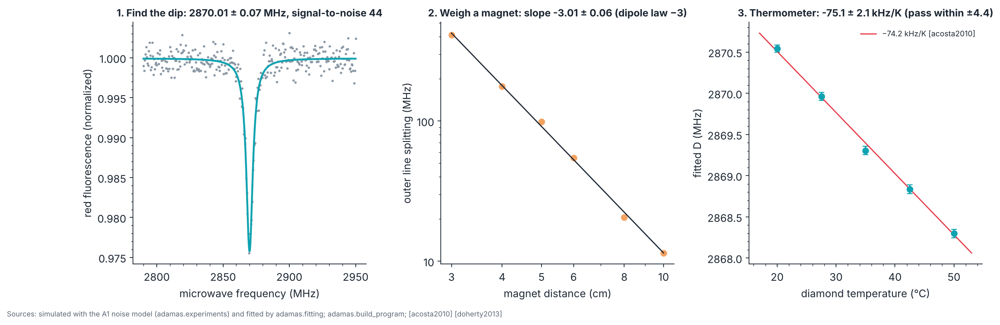

# P1 · Proof of concept: an ODMR magnetometer and thermometer

_Generated from `adamas/build_program.py` (`adamas build docs`); every number below is computed by the package._

**Status: written in full.** Budget: **US$137 to 810** (sum of the part ranges below; approximate 2026 street prices from the experiment list, estimates and not quotes). Gate verdict in simulation: **go**.

## Goal

Build the A1 kit and use it twice: as a magnetometer (the splitting of the lines follows the field of a magnet, experiment A2) and as a thermometer (the zero-field splitting D moves with temperature). Both are ensemble measurements on a diamond with many NV centers.

## Physics and equations

- **Lines in a field** ([Chapter 6](../06_nv_center_physics.md)): f± = D ± γₑB∥ + O(B⊥²/D), γₑ = 28.03 MHz/mT [doherty2013]. Valid while γₑB ≪ D; the Lattice Lab's panel shows the second-order term and its error against exact diagonalization.
- **Dipole field on the magnet's axis:** B = μ₀m/(2πr³), so the splitting falls as r⁻³ (slope −3 on a log-log plot). Valid when r is several times the magnet's size.
- **Temperature:** D(T) ≈ 2870 MHz + (dD/dT)(T − 300 K) with dD/dT = −74.2(7) kHz/K, a weighted average of four samples measured between 280 and 330 K [acosta2010]. The run stays inside that range (20 to 50 °C); over wider ranges D(T) is not linear [toyli2012].

## Machines and consumables

| Atlas | Part (experiment) | Specification | US$ |
|---|---|---|---|
| M31 | NV-rich diamond (A1) | Microdiamond powder or a small HPHT plate with high NV density (irradiated and annealed) | 50 to 250 |
| M30 | Green source (A1) | High-power green LED (safer, visible) or a 532 nm laser module under 1 mW; inexpensive modules can leak invisible infrared pump light, so put a shortpass (infrared-block) filter right after the module | 10 to 60 |
| M32 | Red filter (A1) | Longpass filter near 600 to 650 nm plus an infrared-block filter in front of the photodiode (red filter foil alone passes infrared and leaks green) | 5 to 80 |
| M33 | Photodetector (A1) | Silicon photodiode with a JFET-input transimpedance amplifier (for example TL082) | 10 to 40 |
| M34 | Microwave source (A1) | PLL synthesizer board covering 2.7 to 3.0 GHz (ADF4351-class) | 30 to 60 |
| M35 | Antenna (A1) | Short microstrip line or a copper wire loop under the diamond | 5 to 20 |
| M36 | Controller (A1) | Raspberry Pi Pico (or any microcontroller with SPI, ADC, and USB); ready-made firmware in hardware/a1_odmr | 5 to 40 |
| M37 | Mechanics (A1) | 3-D printed cube mounts or a breadboard; neodymium magnet | 10 to 50 |
| M37 | Ruler or printed rail (A2) | Millimeter scale along the magnet axis | 0 to 10 |
| M37 | Second magnet (optional) (A2) | Different size to compare dipole moments | 0 to 20 |
| M37 | Non-magnetic stand (A2) | Wood or plastic; no steel near the diamond | 0 to 20 |
| M37 | Heater (A3) | Surface-mount power resistor (for example 1 Ω, 2 W) with a small contact area | 2 to 10 |
| M37 | Temperature sensors (A3) | Thermocouples or thermistors, or a low-cost thermal camera | 10 to 150 |

## Facility and safety

A desk. Even a 1 mW green laser can damage eyes: never look into the beam; use a phone camera to align. Measure the module's output with a laser power meter (borrow one) before use, behind the shortpass filter, because labels on cheap modules are unreliable and leaked infrared is invisible. The LED version avoids laser hazards. Microwave powers here are milliwatts; keep the antenna enclosed and away from the body anyway. The heater can exceed 100 °C: do not touch; limit power; never leave unattended.

## Procedure

**Magnetometer (A1, then A2):**

A1:

1. **Mount the diamond on the antenna.** Glue the diamond (or a spot of powder) onto the microstrip or inside the loop; the microwave field must reach it.
2. **Illuminate.** Point the green source at the diamond from a few millimeters. Through the red filter you see red fluorescence: NV centers emitting.
3. **Detect.** Place the filter and photodiode to collect the red light; check that the amplifier output rises when the green light is on.
4. **Sweep.** Step the synthesizer from 2800 to 2940 MHz in 0.5 MHz steps, averaging the detector at each step. With the ADAMAS firmware: python hardware/a1_odmr/host.py --port <port>.
5. **Find the dip.** Plot detector signal versus frequency. A dip of about 0.5 to 3% near 2870 MHz is ODMR. Average longer if it is buried in noise.
6. **Split it.** Bring the magnet closer: the single dip splits into up to eight (four NV orientations × two), moving apart as the field grows.

A2:

1. **Align the magnet.** Place the magnet on the rail, pointing at the diamond, starting 3 cm away.
2. **Record a spectrum.** Sweep as in A1 and note the frequencies of the outermost dip pair.
3. **Step the distance.** Repeat at 3, 4, 5, 6, 8, and 10 cm.
4. **Plot log-log.** Plot splitting against distance on log-log axes; fit a straight line.

**Thermometer (new in P1):** remove the magnets and move steel away (the zero-field spectrum must not change when you move them further); glue the heater resistor and the thermistor next to the diamond on the antenna board; record a zero-field spectrum at 20, 27.5, 35, 42.5, and 50 °C, waiting until the thermistor reading is stable at each; fit each spectrum with `python -m adamas.fit odmr file.csv`, then fit a straight line to the centers, weighted by their uncertainties.

## Expected results (simulated)

The kit is simulated with the A1 noise model of `adamas.experiments` (contrast 1.2 %, line width 6 MHz, noise 0.12 % per point; illustrative kit values, not a measurement) and fitted by `adamas.fitting`, the code you use on real data.

## Pass/fail

| Test | Criterion | Simulated result | Pass? |
|---|---|---|---|
| Find the dip | Signal-to-noise of the fitted depth at least 5 (five-sigma detection), center within half a line width of 2870 MHz | 44; 2870.01 ± 0.07 MHz | yes |
| Magnetometer | Log-log slope within two standard errors of −3 | -3.014 ± 0.063 | yes |
| Thermometer | Slope within two combined standard errors of −74.2 kHz/K (fit and published uncertainty) | -75.1 ± 2.1 kHz/K; tolerance ±4.4 | yes |

A kit that behaves exactly like the model passes the thermometer test in **97.8 %** of 400 simulated runs (more than 95 % because the tolerance also includes the published uncertainty). A single failed run is therefore unlikely to be noise alone; repeat the run before concluding.

## Failure modes

- **Heating moves more than the diamond.** The heater also warms the photodiode, the amplifier, and the laser or LED; their drift changes the baseline, not the line center, so fit centers rather than reading a single frequency.
- **Stray field.** A magnet or steel nearby splits and shifts the lines and mimics a temperature change; check with the magnets removed.
- **Strain.** Many ensembles show a strain splitting at zero field that a single Lorentzian fits poorly; fit two lines and track their mean.
- **Thermistor offset.** Place the sensor as close to the diamond as possible and wait for equilibrium; a lag between sensor and diamond flattens the slope.

## Decision gate

*Is the signal-to-noise good enough to move to pulsed control?* All three continuous-wave tests above pass in simulation. The pulsed decision needs one more number the kit can measure: the dip depth when the microwave is pulsed (P2, experiment B1). Move to P2 when your measured detection signal-to-noise is at least the five-sigma criterion above and the thermometer slope passes.

Sources: [doherty2013] [acosta2010] [stegemann2023] [williams2026] [gruber1997]
