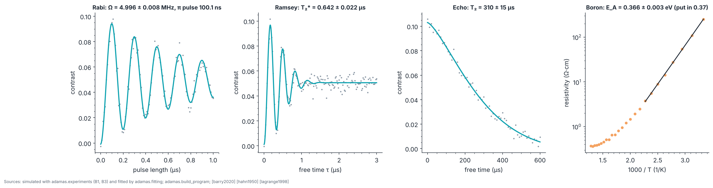

# P2 · Teaching lab: pulsed control, vector magnetometry, and deep dopants

_Generated from `adamas/build_program.py` (`adamas build docs`); every number below is computed by the package._

**Status: written in full.** Budget: **US$5,050 to 22,200** for the parts listed below (approximate 2026 street prices from the experiment list, estimates and not quotes; the experiment pages give reviewer estimates for complete setups: B1 US$5,000 to 12,000, B2 US$1,000 to 3,000, B3 US$1,500 to 6,000). Gate verdict in simulation: **go**.

## Goal

Move from continuous-wave ODMR to pulsed control of an NV ensemble (experiment B1), measure a full magnetic-field vector with the four NV orientations (B2), and measure how deep the boron acceptor in diamond is (B3). These are the skills P3 (single NVs) and P4 (devices) assume.

## Physics and equations

- **Rabi:** P₋₁(t) = (Ω²/Ω_eff²) sin²(πΩ_eff t), Ω_eff = √(Ω² + δ²); a π pulse lasts 1/(2Ω) [rabi1937]. Valid in the rotating-wave limit Ω ≪ D.
- **Ramsey:** the measured contrast follows ½[1 − cos(2πδτ) e^(−(τ/T₂*)²)] (the sign depends on the phase of the last π/2 pulse); the Gaussian envelope comes from quasi-static detunings in an ensemble [ramsey1950] [barry2020].
- **Hahn echo:** C(τ) = e^(−(τ/T₂)ⁿ); the π pulse refocuses static detunings, so T₂ ≫ T₂* [hahn1950]. The stretch n depends on the noise: about 3 for a slow nuclear-spin bath [childress2006] [barry2020]; the simulated data use 1.5.
- **Vector field:** each orientation's half-splitting gives |B·n̂ᵢ|γₑ; for the four tetrahedral axes Σᵢ(B·n̂ᵢ)² = (4/3)|B|², which over-determines the field [rondin2014].
- **Deep acceptor:** p(T) from charge neutrality with E_A = 0.37 eV and compensating donors [lagrange1998]; plotting ln(R T^−0.7) against 1/T removes the T^1.5 density of states [sze2006] and the T^−2.2 lattice mobility [pernot2010], so the slope is E_A/k in the compensated regime.

The Qubit Lab, Lattice Lab, and the Equations in Action page run the same equations.

## Machines and consumables

| Part (experiment) | Specification | US$ |
|---|---|---|
| NV ensemble plate (B1) | CVD or HPHT, 1 to 10 ppm NV | 300 to 1,500 |
| 532 nm laser (B1) | Tens of mW, with an acousto-optic modulator or direct modulation | 500 to 2,500 |
| Optics (B1) | Lenses, mirrors, 600 nm longpass and 900 nm shortpass filters, kinematic mounts | 400 to 1,500 |
| Photodetector (B1) | Amplified silicon photodiode or avalanche photodiode | 150 to 1,000 |
| Microwave chain (B1) | Synthesizer, fast RF switch, 1 to 10 W amplifier, circulator or dump | 800 to 3,000 |
| Pulse timing (B1) | FPGA board (for example Red Pitaya) or a pulse generator with 10 ns resolution | 300 to 1,500 |
| Coils (B1) | Bias coils or a permanent magnet on a translation stage | 100 to 500 |
| Helmholtz coil set (B2) | Three orthogonal pairs, a few mT | 400 to 1,500 |
| Current supplies (B2) | Three channels, 0 to 3 A | 300 to 1,000 |
| Single-crystal NV plate (B2) | Known crystal orientation | 300 to 800 |
| Boron-doped single-crystal diamond (B3) | [B] about 10¹⁷ cm⁻³ with some compensating nitrogen (about 10¹⁶ to 10¹⁷ cm⁻³), four Ti/Pt/Au contacts | 800 to 3,500 |
| Hot stage (B3) | To about 500 °C, in air or nitrogen | 300 to 1,500 |
| Source-measure unit or precision source + meter (B3) | Nanoampere to milliampere | 300 to 2,000 |
| Probes and wiring (B3) | High-temperature probes | 100 to 400 |

## Facility and safety

A teaching lab with laser controls. Class 3B laser: enclosed beam path, wavelength-rated goggles, interlock. Amplified microwaves at watts: terminate every output, never run an open amplifier. Coils heat up at high current: monitor temperature and limit duty cycle. Hot stage burns; use tongs and heat-resistant gloves. Heavily doped electrode-grade material behaves almost like a metal and will not show activation: use lightly doped samples.

## Procedure

B1 (pulsed control):

1. **Polarize and read.** Program: 3 µs laser pulse (initialize), wait, microwave pulse of length τ, 300 ns laser readout window.
2. **Find resonance.** Run continuous ODMR (A1) to find a line; bias field so one NV class is separated.
3. **Rabi.** Sweep τ from 0 to 1 µs: the readout oscillates; half a period is the π pulse.
4. **Ramsey.** π/2, wait τ, π/2 with a small detuning: fringes that decay with T₂*.
5. **Echo.** π/2, τ/2, π, τ/2, π/2: the decay envelope gives T₂, far longer than T₂*.

B2 (vector magnetometry):

1. **Calibrate each axis.** Apply current to one coil pair at a time; record the eight line positions.
2. **Unknown field.** Set an arbitrary combination of currents; record the spectrum.
3. **Fit.** Fit the field vector that best reproduces all eight lines; compare with the coil calibration.

B3 (boron activation):

1. **Contact check.** Verify ohmic contacts with I–V at room temperature (straight line through zero).
2. **Heat in steps.** Step 25 to 500 °C in 25 °C steps; wait for stability; record resistance in both current directions.
3. **Arrhenius plot.** Plot ln(R T^-0.7) against 1000/T and fit the straight low-temperature part (see Analysis).

## Expected results (simulated)

The data are simulated by `adamas.experiments` with the values below put in (illustrative values inside the ranges reported for NV ensembles [barry2020]) and fitted by `adamas.fitting`, the code you use on real data.

## Pass/fail

The gate needs all 5 fitted values to pass (plus the echo threshold, which the simulated data clear by a wide margin), so each test is set for 98.98 % coverage and a correct setup gets "go" 95 % of the time: a fit passes when it lands within 2.57 of its own standard errors of the value it should find (Student-t factor 3.69 for E_A, whose fit uses only 8 points). E_A is compared with the value put in plus the method bias of the T^−0.7 correction, found by fitting the noise-free model. The last column is how often a correct setup passes over 1000 simulated runs (binomial standard error 0.3 percentage points per test, 0.7 for the gate).

| Test | Put in | Fitted | Pass? | Correct setups passing |
|---|---|---|---|---|
| Rabi frequency (π pulse) | 5 MHz | 4.996 ± 0.008 MHz (100.1 ns) | yes | 98.6 % |
| Dephasing T₂* (Ramsey) | 0.6 µs | 0.642 ± 0.022 µs | yes | 98.8 % |
| Coherence T₂ (echo) | 300 µs | 310 ± 15 µs | yes | 98.0 % |
| Field magnitude from four orientations | 2.518 mT | 2.542 ± 0.018 mT (error from a 1 % line uncertainty) | yes | 99.5 % |
| Boron activation energy | 0.37 eV (method bias -0.0043) | 0.366 ± 0.003 eV | yes | 99.4 % |
| Echo outlives dephasing (this project's threshold) | T₂/T₂* > 10 | 482 | yes | |
| **Gate: every row passes** | | | **yes** | **94.4 %** |

A correct setup still fails the gate about one time in twenty, so a single "stop" is a reason to repeat the failing measurement, not to abandon the phase. On real data, use each line's fit uncertainty for the field-magnitude error instead of the 1 % assumed here; P2 tests the field's magnitude, not its direction.

## Not yet simulated

The longitudinal relaxation time T₁ belongs in this phase but has no model in the package yet, so it has no pass/fail criterion here ([STATUS.md](../STATUS.md)).

## Failure modes

- **Microwave power drift** changes Ω between Rabi and Ramsey runs; recalibrate the π pulse before each sequence.
- **Pulse timing:** a π pulse that is not centred lets static detuning back in (the Qubit Lab shows how fast this hurts).
- **Coil heating (B2):** the field drifts as the coils warm; limit duty cycle and recalibrate each axis.
- **Contacts (B3):** non-ohmic contacts on diamond add their own temperature dependence; check the current-voltage curve is straight at every temperature.
- **Uncompensated samples (B3):** the slope approaches E_A/2; the sample's compensation must be known before comparing.

## Decision gate

*Can we hold a spin coherent and measure deep dopants reliably?* All simulated tests pass, so the procedure and the analysis are ready; the gate is decided by the measured values on your setup. Go to P3 when your measured T₂ is long enough for the single-NV gates you plan (the gate budget in E5) and to P4 when the B3 activation energy is reproduced on your samples.

Sources: [rabi1937] [ramsey1950] [hahn1950] [childress2006] [barry2020] [rondin2014] [lagrange1998] [sze2006] [pernot2010] [sewani2020]
