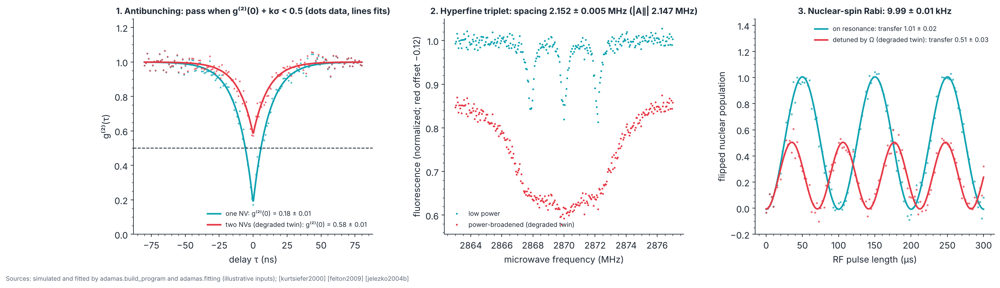

# P3 · Single NV: one emitter, its nuclear spin, and a two-qubit register

_Generated from `adamas/build_program.py` (`adamas build docs`); every number below is computed by the package._

**Status: written in full.** Budget: **US$24,000 to 116,000** for the C1 parts listed below (approximate 2026 street prices from the experiment list, estimates and not quotes; the experiment page gives a reviewer estimate of US$30,000 to 100,000 for a complete setup). The RF source for the nuclear spin is not priced yet ([STATUS.md](../STATUS.md)). Gate verdict in simulation: **go**.

Every input below is **illustrative** (chosen to look like a typical room-temperature confocal setup, not measured), except the ¹⁴N hyperfine constant, which is sourced. The phase is **simulated**: no ADAMAS hardware has run it.

## Goal

Find one NV center, prove it is one (photon antibunching), resolve the ¹⁴N nuclear spin it carries (hyperfine triplet), and rotate that nuclear spin coherently (nuclear-spin Rabi). These are the Device Library's QDL-01 (electron-spin qubit cell) and QDL-02 (nuclear-spin memory) on one NV, the pair that QDL-03 (electron–nuclear conditional gate) entangles; QDL-03's gate is not tested here.

## Physics and equations

- **Antibunching:** one emitter cannot give two photons at once, so the normalized coincidence rate g⁽²⁾(τ) = 1 − (1 − g₀) e^(−|τ|/τ₁) dips at zero delay [kurtsiefer2000]. For N identical, independent emitters seen through uncorrelated background, g₀ = 1 − ρ²/N, where ρ is the fraction of detected light that comes from the emitters. Valid for continuous excitation and a detector time resolution much shorter than τ₁. g₀ < 0.5 rules out two or more emitters. Simulated with ρ² = 0.8 (illustrative), so one NV gives g₀ = 0.20 and two give 0.60.
- **Hyperfine triplet:** the ¹⁴N nucleus (spin 1) splits each electron-spin line into three, spaced by |A∥| = 2.147 MHz [felton2009]. The lines are resolved only when each is narrower than the spacing, so the microwave power must be low (power broadening widens the line). Simulated at zero field with a 0.4 MHz line width (illustrative).
- **Nuclear-spin Rabi:** an RF field drives the nuclear spin; the flipped population is P(t) = (Ω²/Ω_eff²) sin²(πΩ_eff t), Ω_eff = √(Ω² + δ²). Valid in the rotating-wave limit (Ω much smaller than the RF frequency) and over a window short compared with the nuclear coherence time. The nuclear state is read through the electron: a microwave π pulse selective on one hyperfine line flips the electron only for one nuclear state, then the electron is read optically [jelezko2004b]. In the electron's ms = 0 state the ¹⁴N transitions sit near the quadrupole frequency |P| = 5.016 MHz [felton2009], split by any bias field. Simulated with Ω = 10 kHz (illustrative).

The Photon Lab runs the antibunching equation.

## Machines and consumables

Atlas machines for this phase: M47 High numerical-aperture objective, M48 Galvo or piezo scanning, M49 Two single-photon avalanche diodes (SPADs), M50 Time tagger (picosecond correlator), M51 Arbitrary waveform generator (AWG), M52 Electronic-grade, low-nitrogen, optionally ¹²C-enriched CVD diamond, M53 RF source for nuclear spins (MHz range), M54 Two-color excitation for charge-state readout (orange or red laser).

| Atlas | Part (experiment) | Specification | US$ |
|---|---|---|---|
| M47 | Oil or air objective (C1) | Numerical aperture 0.9 to 1.4 | 1,500 to 8,000 |
| M48 | Scanning (C1) | Galvo mirrors or a piezo stage | 3,000 to 20,000 |
| M49 | Single-photon detectors (C1) | Two silicon avalanche photodiodes in Geiger mode | 6,000 to 20,000 |
| M50 | Time tagger (C1) | Picosecond-resolution correlator | 5,000 to 20,000 |
|  | Laser and optics (C1) | 532 nm, fiber coupling, pinhole, filters | 3,000 to 15,000 |
| M52 | Electronic-grade diamond (C1) | Low-nitrogen CVD with sparse NV | 500 to 3,000 |
| M51 | Microwave and control (C1) | Arbitrary waveform generator, amplifier | 5,000 to 30,000 |
| M53 | RF source for nuclear spins (MHz range) | needed for the nuclear-spin test | not priced (no source yet) |

## Facility and safety

A research lab with an optical table and a laser-controlled area. Class 3B/4 laser; fiber ends and objective focus are especially hazardous. Immersion oil: keep off optics other than the objective. Class 3B and 4 lasers need your institution's laser-safety training and a named laser-safety officer before first light; this page does not replace that training.

## Procedure

C1 (find and prove a single NV, resolve its nucleus):

1. **Scan.** Raster-scan a 20 × 20 µm field; isolated bright spots are NV candidates.
2. **Correlate.** Park on a spot; split fluorescence onto two detectors; histogram photon-pair delays.
3. **Check g⁽²⁾(0).** A dip below 0.5 at zero delay proves a single emitter.
4. **Resolve hyperfine.** Low-power ODMR on that NV shows three lines about 2.15 MHz apart from the ¹⁴N nucleus [felton2009].

Nuclear-spin Rabi (extends C1, uses Atlas M53):

1. **Pick a nuclear transition.** Apply a small bias field along the NV axis so the ¹⁴N transitions near |P| no longer overlap; find the one you want with an RF sweep read through the electron.
2. **Map the nucleus onto the electron.** Calibrate a microwave π pulse that is selective on one hyperfine line (Rabi frequency well below 2.147 MHz).
3. **Sweep the RF pulse length.** For each length: initialize with the green laser, apply the RF pulse, apply the selective π pulse, read the electron optically. Record bright (ms = 0) and dark (ms = −1) reference counts in the same run and normalize with them.
4. **Fit.** `python -m adamas.fit rabi nuclear.csv` (time in µs); the transferred population is twice the fitted amplitude.

## Expected results (simulated)

Each test is shown with its **degraded twin**: the same simulation with one physical fault, which the test must catch.

## Pass/fail

The gate needs all 3 tests to pass, so each is set for 98.30 % coverage and a correct setup gets "go" at least 95 % of the time: k = 2.39 standard errors. Rates are over 400 simulated runs (binomial standard error 0.6 percentage points per test, 1.1 for the gate).

| Test | Criterion | Put in | Fitted | Pass? | Correct setups passing |
|---|---|---|---|---|---|
| One emitter (antibunching) | g⁽²⁾(0) + kσ < 0.5 | g₀ = 0.20 | 0.180 ± 0.012 | yes | 100.0 % |
| Nuclear spin resolved (hyperfine) | three lines; mean spacing within kσ of 2.147 MHz [felton2009] | 2.147 MHz | 2.152 ± 0.005 MHz | yes | 98.0 % |
| Nuclear spin driven (Rabi) | transferred population within kσ of 1 | Ω = 10 kHz, δ = 0 | 1.014 ± 0.021 (9.99 ± 0.01 kHz) | yes | 99.5 % |
| **Gate: every row passes** | | | | **yes** | **97.5 %** |

The degraded twins, one fault each. The last column is how often the faulty setup wrongly passes.

| Test | Fault | Fitted | Pass? | Faulty setups passing |
|---|---|---|---|---|
| Antibunching | two NVs in the focus (g₀ = 0.60) | 0.580 ± 0.012 | no | 0.0 % |
| Hyperfine | power-broadened line, 3 MHz wide | 1 line(s) found, triplet not resolved | no | 0.5 % |
| Nuclear Rabi | RF detuned by one Rabi frequency (half the population moves) | 0.510 ± 0.025 | no | 0.0 % |

The antibunching test passes correct setups more often than its 98.30 % design because it is one-sided and the simulated g₀ sits well below 0.5. The nuclear Rabi fit leaves its decay time free over a window with no decay, which inflates the amplitude's error, so that test is also conservative. A single "stop" on real data is a reason to repeat the failing measurement before changing the setup.

## Not yet simulated

- **Single-shot readout** of the nuclear spin (repetitive readout [neumann2010science]) belongs to this phase; the Device Library's readout check covers optical readout only, so it has no criterion here.
- **Charge state** (NV⁻ versus NV⁰) under the green laser, which Atlas M54 measures, has no model in the package yet.
- **The electron–nuclear gate** (CNOT) is computed in `adamas.register` as a Bell-state fidelity, not a gate fidelity, and is not part of this gate ([STATUS.md](../STATUS.md)).

## Failure modes

- **Two emitters in the spot:** g⁽²⁾(0) near 0.5 or above; move to another spot or use a sample with fewer NVs.
- **Background light:** raises g⁽²⁾(0) for a single NV too; tighten the pinhole and the filters before blaming the emitter.
- **Power broadening:** the triplet merges into one line; lower the microwave power until the lines separate.
- **Detuned RF:** the nuclear Rabi oscillation is faster and never reaches full contrast; re-find the transition with an RF sweep.
- **Drift:** the stage drifts off the NV during long runs; re-centre on the spot between measurements.

## Decision gate

*Do we have single, addressable registers?* All simulated tests pass and every degraded twin fails, so the analysis can tell a working register from a broken one; the gate is decided by the measured values on your setup. Go to P5 (placement) when one emitter, its resolved nucleus, and full nuclear Rabi contrast are measured on the same NV.

Sources: [kurtsiefer2000] [gruber1997] [jelezko2004a] [jelezko2004b] [felton2009] [doherty2013] [neumann2010science]
