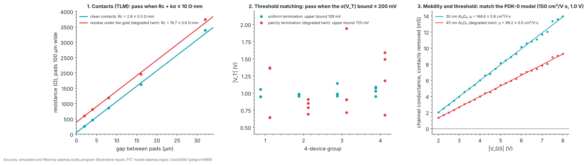

# P4 · Devices: hydrogen-terminated diamond field-effect transistors

_Generated from `adamas/build_program.py` (`adamas build docs`); every number below is computed by the package._

**Status: written in full.** Budget: **US$7,000 to 51,000** for the C2 parts listed below (approximate 2026 street prices from the experiment list, estimates and not quotes; the experiment page gives a reviewer estimate of US$10,000 to 50,000). The high-voltage curve tracer and the photoelectric readout chain are not priced yet ([STATUS.md](../STATUS.md)). Gate verdict in simulation: **go**.

Every input below is **illustrative**: the transistor values are the PDK-0 design values of `adamas.logic` (the ones the Transistor Lab and the SPICE models use, chosen inside published ranges), and the rest are chosen to look like a typical run. The pass limits come from the process traveler (S08 and S17). The phase is **simulated**: no ADAMAS hardware has run it.

## Goal

Run process traveler T1 on one or two plates in a university cleanroom (experiment C2) and turn the PDK-0 monitor die into numbers: contact and sheet resistance, threshold matching, and the channel mobility and threshold of the field-effect transistor (FET). P4 is the classical track; it meets the quantum track (P3, P5) at P6.

## Physics and equations

- **Transfer length method (TLM):** pads of width W at gaps d give R(d) = 2R_c/W + R_sh·d/W, two contacts in series with the channel [sze2006]. A straight line through R(d) gives the sheet resistance R_sh from the slope and the contact resistance R_c from the intercept. Valid for contacts longer than the transfer length and a uniform sheet. The PDK-0 ladder has pads 100 µm wide and gaps of 2, 4, 8, 16, 32 µm (`adamas.pdk0`).
- **Threshold matching:** the spread of V_T between nominally identical, closely spaced transistors falls with gate area [pelgrom1989]; the traveler (S17) limits σ(V_T) in 4-device groups to 200 mV. Four groups of four give a pooled estimate s with 12 degrees of freedom; its upper confidence bound is s·√(12/χ²), using the χ² quantile at the per-check coverage.
- **Mobility and threshold:** in the linear (triode) region at small V_DS the square law gives I_D = k(V_GS − V_T)V_DS, k = µC_ox·W/L [sze2006], with C_ox = ε_ox ε₀/t_ox. The two contacts add R_s = 2R_c/W in series, so the channel conductance is g = I_D/(V_DS − I_D R_s), straight in V_GS: slope k, intercept −kV_T. Valid at V_DS much smaller than V_GS − V_T and for a long channel. The PDK-0 FET: µ = 150 cm²/V·s, |V_T| = 1.0 V, 30 nm Al₂O₃ (relative permittivity 9), W/L = 100/2 µm (`adamas.logic`, illustrative).

Diamond FETs are p-channel; magnitudes are used throughout, as in `adamas.logic`. The Transistor Lab runs the same square law.

## Machines and consumables

Atlas machines for this phase: M10 Wet bench: tri-acid and piranha cleans, HF, M11 Optical lithography (mask aligner or laser writer), M12 Electron-beam lithography, M13 Electron-beam evaporator (Ti/Pt/Au, Au), M14 Atomic layer deposition (ALD) of Al₂O₃, M15 Oxygen plasma asher or reactive-ion etch for isolation, M16 Inductively coupled plasma reactive-ion etching (ICP-RIE), M17 Probe station, hot chuck, semiconductor parameter analyzer, M18 High-voltage curve tracer for breakdown, M19 Profilometer, optical microscope, four-point probe, M55 Photoelectric readout chain (bias electrodes, lock-in, transimpedance).

| Atlas | Part (experiment) | Specification | US$ |
|---|---|---|---|
| (not in the Atlas) | Single-crystal plates (C2) | 3 × 3 to 5 × 5 mm, (100) | 1,000 to 6,000 |
| M10 to M16 | Cleanroom access (C2) | Tool-time fees for lithography, evaporation, ALD, plasma | 5,000 to 30,000 |
| M01 | Hydrogen plasma (C2) | MPCVD time at a partner lab | 1,000 to 5,000 |
| M17 | Probe station and analyzer (C2) | Often available in the department | 0 to 10,000 |
| M18 | High-voltage curve tracer for breakdown | breakdown tests (not yet simulated) | not priced (no source yet) |
| M55 | Photoelectric readout chain (bias electrodes, lock-in, transimpedance) | photoelectric NV readout (not yet simulated) | not priced (no source yet) |

## Facility and safety

A university cleanroom with wet benches, lithography, evaporation, atomic layer deposition (ALD), plasma tools and a probe station. Perchloric acid only in a perchloric-rated hood with wash-down; perchlorate residues are explosive. Hot concentrated acids: face shield, acid apron, heavy gloves; never add organics. Never boil a perchloric mixture to dryness: hot sulfuric acid can dehydrate HClO₄ to explosive anhydrous perchloric acid; top up or stop well before the volume falls. NO₂ is highly toxic: gas cabinet, continuous monitoring, exhausted enclosure, buddy system. Trimethylaluminium is pyrophoric: sealed source, trained operators, never open to air. Hot chuck burns; high-voltage breakdown tests only behind shields. Hydrofluoric and perchloric acids, nitrogen dioxide, trimethylaluminium and high-voltage tests each need your institution's specific training and sign-off before first use; this page does not replace that training.

## Procedure

C2:

1. **Plan the run.** Pick the variant in docs/process/APPLICATIONS.md; draw the PDK-0 monitor die (make layout).
2. **Run the traveler.** Follow S01 to S17 in process.html, logging every check.
3. **Test.** Measure TLM, MOS capacitor, transistor, and ring oscillator at 25 and 200 °C.
4. **Calibrate the models.** Enter the measured parameters into adamas.logic and the SPICE models (projects P-3, D-2).

On the monitor die (traveler S17): measure the TLM ladder first, so its contact resistance is available when you extract the FET; then the four 4-device FET groups (transfer curve at |V_DS| = 0.1 V, |V_GS| from 2 to 8 V); then the MOS capacitor (C–V), which measures C_ox directly instead of assuming the oxide thickness.

## Expected results (simulated)

Each test is shown with its **degraded twin**: the same simulation with one process fault, which the test must catch.

## Pass/fail

The gate needs all 4 checks to pass, so each is set for 98.73 % coverage: k = 2.23 for the one-sided contact-resistance check and 2.49 for the two-sided mobility and threshold checks; the matching check uses the χ² bound at the same coverage. Each test draws its own noise. Rates are over 1000 simulated runs (binomial standard error at the design rate: 0.4 percentage points per check, 0.7 for the gate).

| Check | Criterion | Put in | Measured | Pass? | Correct runs passing |
|---|---|---|---|---|---|
| Contact resistance (TLM) | R_c + kσ ≤ 10 Ω·mm (S17); R_sh in 3 to 30 kΩ/sq (S08) | R_c 3 Ω·mm, R_sh 10 kΩ/sq | R_c 2.85 ± 0.32 Ω·mm, R_sh 10.08 ± 0.14 kΩ/sq | yes | 100.0 % |
| Threshold matching | upper bound on σ(V_T) ≤ 200 mV (S17) [pelgrom1989] | σ = 60 mV | s = 61 mV, bound 109 mV | yes | 100.0 % |
| Mobility | within kσ of 150 cm²/V·s (PDK-0) | 150 | 148.6 ± 0.8 | yes | 97.7 % |
| Threshold | within kσ of 1 V (PDK-0) | 1 V | 0.980 ± 0.012 V | yes | 98.0 % |
| **Gate: every row passes** | | | | **yes** | **96.7 %** |

The degraded twins, one process fault each. The last column is how often the faulty run wrongly passes.

| Test | Fault | Measured | Pass? | Faulty runs passing |
|---|---|---|---|---|
| Contact resistance | residue under the gold contacts (R_c = 20 Ω·mm) | 19.7 ± 0.6 Ω·mm | no | 0.0 % |
| Threshold matching | patchy hydrogen termination (σ = 400 mV) | s = 406 mV, bound 725 mV | no | 0.0 % |
| Mobility and threshold | Al₂O₃ 45 nm thick, analysis assumes 30 nm | µ 99.2 ± 0.5 cm²/V·s, V_T 0.981 V | no | 0.0 % |

The contact and matching checks pass correct runs more often than 98.73 %, because the values put in sit well inside their limits. The mobility and threshold checks pass slightly less often than designed (97.7 % and 98.0 %): the conductance is computed from noisy currents, and the weights use the measured rather than the true currents. The two are also correlated (one fit gives both), so the gate rate is not the product of the rows. The gate still passes correct runs at least 95 % of the time.

A failed mobility or threshold check on real devices says the device and the model disagree. The MOS capacitor tells you which: if C_ox matches 30 nm of Al₂O₃, the mobility is really different, and the model should be recalibrated with the measured value (C2, step 4); if not, the oxide is off.

## Not yet simulated

- **Hot operation** (traveler S17 tests at 25, 200 and 300 °C [kawarada2014]): the FET model has no temperature dependence yet.
- **Breakdown** (Atlas M18): the breakdown field versus dislocation density has a proposed fit in `adamas.power`, but no simulated test structure here.
- **On/off ratio** (S17: at least 10⁶) and **ring-oscillator delay** (S17: within a factor of 2 of the model): no noise model for the off current or the oscillator yet.
- **Photoelectric NV readout** (Atlas M55): belongs to the quantum track and P6.

## Failure modes

- **Contact residue:** high R_c with a normal R_sh; keep the surface clean and the time short between hydrogen termination (S08) and the gold (S09).
- **Lost termination:** high R_sh everywhere, or patchy termination that shows as a large threshold spread; repeat the hydrogen plasma (S08) and store in clean nitrogen.
- **Oxide thickness off:** mobility off by the oxide ratio; measure C_ox on the MOS capacitor and check the ALD cycle count.
- **Threshold drift during hot tests:** mobile charge or NO₂ desorption (traveler S17); use the high-temperature oxide option for hot operation.

## Decision gate

*Do our devices match the models, and is the process stable from run to run?* All simulated checks pass and every degraded twin fails, so the analysis can tell a good run from a faulty one; the gate is decided by the measured values on your wafer. Run-to-run stability needs at least two runs through the same checks; go to P6 when both runs pass and the measured mobility and threshold have been entered into the models.

Sources: [sze2006] [pelgrom1989] [kawarada2014] [kawarada2023] [kasu2012] [liu2017]
