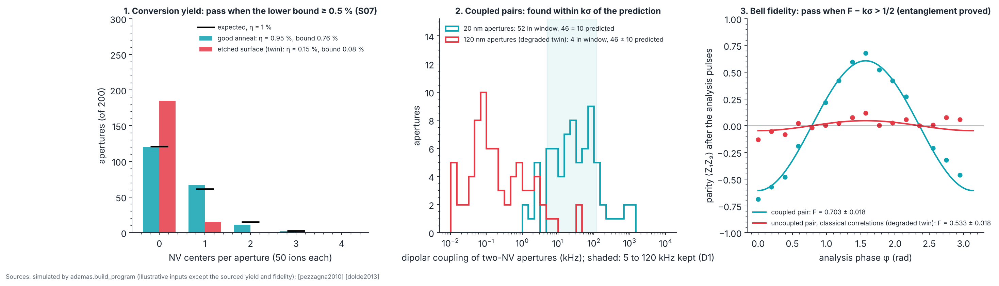

# P5 · Placement: implanted NV pairs, coupled and entangled

_Generated from `adamas/build_program.py` (`adamas build docs`); every number below is computed by the package._

**Status: written in full.** Budget: **US$370,000 to 1,600,000** for the D1 parts listed below (estimates from the experiment list, not quotes). The annealing furnace and secondary-ion mass spectrometry (SIMS) are rented by the hour in a shared facility; the table gives published hourly rates, which are not added to the total because the hours are not modelled. Gate verdict in simulation: **go**.

Sourced inputs: the conversion yield put in (1 %) come from [pezzagna2010], and its acceptance limit (0.5 %, traveler step S07) is an ADAMAS target set from it; the Bell-state fidelity put in (0.67) is the published room-temperature value for an NV pair [dolde2013]; the 5 to 120 kHz coupling window is experiment D1's. Every other input (aperture counts, ions per aperture, noise levels) is **illustrative**. The phase is **simulated**: no ADAMAS hardware has run it.

## Goal

Place nitrogen-vacancy (NV) centers with nanometre control: implant ¹⁵N through apertures (traveler S06), anneal so vacancies find the nitrogen (S07), count how many ions became NV centers, find apertures that hold exactly two NVs coupled strongly enough for a two-qubit gate, and entangle one such pair at room temperature. P5 answers whether placement is good enough to plan arrays (P6).

## Physics and equations

- **Conversion yield η:** each implanted nitrogen becomes an NV with probability η, so an aperture with n ions holds k NVs with the binomial probability C(n,k) η^k (1 − η)^(n−k). Counting NVs on a witness array of M apertures gives η̂ = (NVs counted)/(M n); its one-sided Clopper–Pearson lower bound at the per-check coverage is compared with the S07 limit. About 1 % is reported at 2.5 to 5 keV, rising with energy [pezzagna2010]. Valid when every NV in an aperture is counted (confocal counting: brightness steps calibrated on single NVs, with antibunching from P3 to confirm single centers; two versus three is the least certain count) and implanted ¹⁵N is told from native ¹⁴N by its hyperfine lines.
- **Where the ions stop:** at 5 keV the rule of thumb of `adamas.coupling` gives a depth of about 7.5 nm with 3.0 nm straggle, per axis [pezzagna2010] [oforiokai2012]; replace it with a run of SRIM (the Stopping and Range of Ions in Matter code) [ziegler2010] for design work (channeling makes real profiles deeper). Each ion enters at a uniformly random point of a 20 nm aperture. 50 ions per aperture is a local fluence of about 1.6e+13 cm⁻², above S06's range for single centers and at its ensemble ceiling, so the 1 % yield is extrapolated to this fluence (an assumption to check on the witness array).
- **Coupling:** two NVs at separation r couple with ν = 52 MHz·nm³ |1 − 3cos²θ| / r³ [neumann2010natphys] [dolde2013], θ between the separation and the quantization axis (taken here as [111] for both; NVs on different axes, as experiment D1 selects for addressing, change the angular factor). A controlled-phase gate takes 1/(2ν). Each candidate's coupling is measured by double electron–electron resonance (DEER), and pairs between 5 and 120 kHz are kept (experiment D1's window).
- **Pair count:** an aperture with n ions holds exactly two NVs with P₂ = C(n,2) η² (1 − η)^(n−2), and a fraction f of such pairs falls in the window (Monte Carlo over the geometry above; f = 0.663 for the design). The expected number of usable pairs in M apertures is N = M P₂ f, computed with the yield **measured** on the witness array of the same run; its error combines binomial counting and the yield's error, so the yield and pair checks are correlated.
- **Bell fidelity:** after the gate, measure the populations p00 + p11 and the parity ⟨Z₁Z₂⟩ after a π/2 analysis pulse of phase φ on each NV. Its cos 2φ part is −A cos 2φ with A = 2 Re ρ(00,11), so F = (p00 + p11 + A)/2 is the exact fidelity with the Bell state |Φ⁺⟩ for any two-qubit state (a test checks it on random states). A fidelity above 1/2 proves entanglement: no unentangled (separable) state reaches more than 1/2 with a Bell state, which a test checks numerically. The simulated state is a Bell pair mixed with white noise (a Werner state, as in `adamas.entangle`); real errors are not white, but the estimator does not depend on that.

## Machines and consumables

Atlas machines for this phase: M08 Photoluminescence (PL) and NV-density mapping, M10 Wet bench: tri-acid and piranha cleans, HF, M12 Electron-beam lithography, M20 Low-energy ion implanter (¹⁵N), M21 Aperture masks (PMMA, AFM-tip) or focused ion beam, M22 High-vacuum annealing furnace (800–1200 °C), M23 Secondary-ion mass spectrometry (SIMS), M24 Atomic force microscopy (AFM), M47 High numerical-aperture objective, M51 Arbitrary waveform generator (AWG), M52 Electronic-grade, low-nitrogen, optionally ¹²C-enriched chemical vapor deposition (CVD) diamond, M54 Two-color excitation for charge-state readout (orange or red laser). Optional: M25 (laser writing of vacancies) to raise the yield, and M08 for photoluminescence maps of the witness array.

| Atlas | Part (experiment) | Specification | US$ |
|---|---|---|---|
| M20, M21 | Implantation (D1) | Aperture implantation or scanning-probe implantation of ¹⁵N | 100,000 to 800,000 |
| M47, M54 | Confocal setups (D1) | Two-color, with charge-state readout | 150,000 to 400,000 |
| M51 | Control electronics (D1) | Multi-channel arbitrary waveform generators, amplifiers | 100,000 to 300,000 |
| M52 | Materials (D1) | Isotopically purified ¹²C diamond | 20,000 to 100,000 |
| M22 | High-vacuum annealing furnace (800–1200 °C) | vacancy anneal (S07) | US$63 to 189 per hour, RTA (closest listed tool) [wnf2026] ([Atlas](ATLAS.md)) |
| M23 | Secondary-ion mass spectrometry (SIMS) | implant depth profile (S06) | US$90 to 225 per hour, ToF-SIMS [maf2023] ([Atlas](ATLAS.md)) |

## Facility and safety

A shared ion-beam facility with a low-energy implanter, an electron-beam lithography tool for the aperture mask, a high-vacuum furnace, a wet bench, and a confocal microscope with microwave control. Perchloric acid only in a perchloric-rated hood with wash-down; perchlorate residues are explosive. Hot concentrated acids: face shield, acid apron, heavy gloves; never add organics. Never boil a perchloric mixture to dryness: hot sulfuric acid can dehydrate HClO₄ to explosive anhydrous perchloric acid; top up or stop well before the volume falls. Ion implanter: radiation (X-ray) interlocks and high voltage. Furnace hot-zone burns; vacuum implosion shielding. Class 3B/4 laser: interlocked enclosure, wavelength-rated eyewear. Institutional laser, radiation (implanter), and high-voltage programs. Ion implanters, furnaces, strong acids and Class 3B/4 lasers each need your institution's specific training and sign-off before first use; this page does not replace that training.

## Procedure

Traveler steps S06 (implant through apertures) and S07 (anneal, tri-acid clean, oxygen termination), then D1:

1. **Place pairs.** Implant ¹⁵N; the published pairs used MeV ions through nano-channels (about 2% pair success) rather than keV ions through thin apertures; anneal; tri-acid clean (traveler S06, S07).
2. **Find pairs.** Both NVs sit inside one laser spot. Pick pairs on different ⟨111⟩ axes (lines about 30 MHz apart in the bias field), so each can be driven alone; measure the dipolar splitting and keep pairs with 5 to 120 kHz coupling.
3. **Pre-select the charge state.** Before each run, check that both NVs are NV⁻ with a 594 nm readout and discard runs that fail, as in [joas2025]; [dolde2013] normalized its data to charge-preselected runs.
4. **Entangle.** Echoed gate sequence; Bell-state tomography with joint readout of both NVs.
5. **Beat the budget.** Compare with the adamas.gate_budget coherence limit; attribute the rest to dephasing, pulses and initialization.

On the sample, keep two fields side by side: a **witness array** (200 apertures, 50 ions each) that is only counted, and a **pair field** (1000 apertures, 50 ions each) that is searched for coupled pairs. Count the witness array first, so its yield is available when you predict the pair count.

## Expected results (simulated)

Each test is shown with its **degraded twin**: the same simulation with one fault, which the test must catch.

## Pass/fail

The gate needs all 3 checks to pass, so each is set for 98.30 % coverage: the yield check uses the exact Clopper–Pearson quantile, the Bell check k = 2.12 (one-sided) and the pair count k = 2.39 (two-sided). Rates are over 1000 simulated runs (binomial standard error at the design rate: 0.4 percentage points per check, 0.7 for the gate).

| Check | Criterion | Put in | Measured | Pass? | Correct runs passing |
|---|---|---|---|---|---|
| Conversion yield (witness array) | lower bound ≥ 0.5 % (S07, ADAMAS target) | η = 1 % | 95 NVs from 10,000 ions: 0.95 ± 0.10 %, bound 0.76 % | yes | 100.0 % |
| Coupled pairs (pair field) | at least 1 found, and within kσ of the prediction | design aperture 20 nm | 73 two-NV apertures, 52 in the window; predicted 46.3 ± 9.9 | yes | 97.9 % |
| Bell fidelity (strongest pair: 117.8 kHz, gate time 1/(2ν) = 4.2 µs) | F − kσ > 1/2 | F = 0.67 [dolde2013] | 0.703 ± 0.018 | yes | 100.0 % |
| **Gate: every row passes** | | | | **yes** | **97.9 %** |

The degraded twins, one fault each. The last column is how often the faulty run wrongly passes.

| Test | Fault | Measured | Pass? | Faulty runs passing |
|---|---|---|---|---|
| Conversion yield | residual oxygen etched the surface during the anneal (S07 failure mode; η = 0.2 %, illustrative) | 0.15 %, bound 0.08 % | no | 0.0 % |
| Coupled pairs | the poly(methyl methacrylate) (PMMA) resist over-developed: apertures 120 nm, outside the S06 window of 10 to 60 nm | 4 in the window, 46.3 ± 9.9 predicted | no | 0.0 % |
| Bell fidelity | the "pair" is not coupled: at best classical correlations, F = 1/2 | 0.533 ± 0.018 | no | 2.5 % |

Against the 98.30 % design per check: the yield check passes correct runs more often than designed (100.0 %); the pair-search check passes correct runs about as often as designed (97.9 %); the Bell check passes correct runs more often than designed (100.0 %). With these inputs the yield and Bell checks sit far from their limits (1 % against 0.5 %, a fidelity of 0.67 against 1/2), so the pair-search check sets the gate rate. The Bell twin sits exactly on the limit (F = 1/2), so by construction it passes at the one-sided rate 1.7 %; over these runs it passed 2.5 %, within three standard errors of that. A real pair just above 1/2 would also fail often: the test proves entanglement only when the fidelity clears 1/2 by a few standard errors. Over 1000 runs the gate passes 97.9 % of correct runs, at least the 95 % it is designed for.

The simulation puts in the published fidelity rather than computing it. The coherence-limited budget of `adamas.gate_budget` gives 0.78 to 1.00 for the published pair, above the measured 0.67: a known discrepancy carried here from P0 ([VALIDATION.md](../VALIDATION.md)). P5 is where it gets measured: compare your fidelity with the budget for your pair's coupling and coherence times, and attribute the gap (D1, step 5).

## Not yet simulated

- **Depth-dependent coherence:** shallow NVs lose coherence to surface spins [oforiokai2012]; S07 asks for an echo T₂ of at least 10 µs (an ADAMAS target), and the budget needs the measured value.
- **Charge state:** the Bell check assumes charge-state pre-selected runs (D1, step 3). Without pre-selection an unprepared fraction 1 − q² of runs drags the fidelity toward 1/4 (`adamas.gate_budget`).
- **Addressing:** pairs on the same crystal axis cannot be driven one at a time (Addressing Lab); the pair search here does not reject them.
- **Deterministic placement** (laser writing, M25; single-ion detection): not modelled.

## Failure modes

- **Low yield, dark surface layer:** residual oxygen etched the surface during the anneal (S07); improve the vacuum or use forming gas.
- **Too few or too many NVs per aperture:** dose or aperture size off (S06); recalibrate on the witness array.
- **Pairs too far apart:** apertures wider than designed (check them by scanning electron microscopy, S06) or straggle larger than planned (deeper or channeled ions; SIMS).
- **Fidelity at or below 1/2:** weak coupling, short T₂ near the surface, pulse errors, or a mis-identified pair; repeat the coupling measurement and the coherence times before blaming the gate.

## Decision gate

*Is placement yield good enough to plan arrays?* All simulated checks pass and every degraded twin fails, so the analysis can tell a good run from a faulty one; the gate is decided by the numbers measured on your sample. An array of N cells needs N usable pairs; with the measured yield and window fraction, about 1/(P₂ f) = 22 apertures are searched per usable pair at this dose. That is optimistic: D1 also needs the two NVs on different axes so each can be driven alone, which for random orientations keeps 3 of 4 pairs (about 29 apertures per pair), and the [111]-only angular factor is an approximation. That number, not the gate verdict alone, decides whether P6 plans arrays of aperture-implanted pairs or waits for deterministic placement.

Sources: [pezzagna2010] [dolde2013] [oforiokai2012] [ziegler2010] [neumann2010natphys] [wnf2026] [maf2023] [joas2025]
