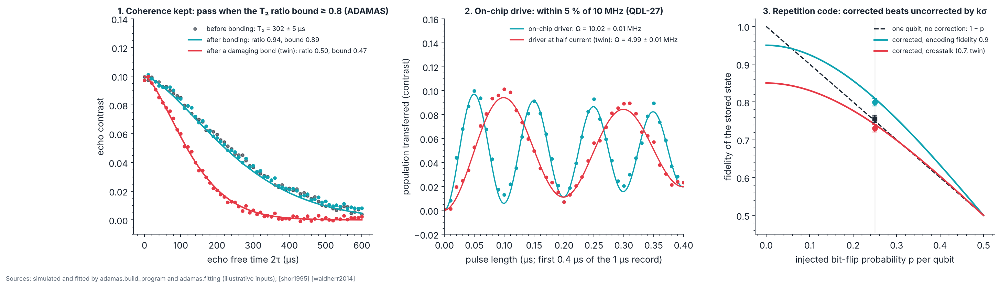

# P6 · Integration: diamond chiplets on silicon control

_Generated from `adamas/build_program.py` (`adamas build docs`); every number below is computed by the package._

**Status: written in full.** Budget: **not priced.** No sourced price exists yet for a multi-project wafer (MPW) shuttle, die bonding or packaging, so this page lists the machines without prices ([STATUS.md](../STATUS.md)). Gate verdict in simulation: **go**.

Every input is **illustrative** except where a source or a device-library entry is named: the echo and Rabi data reuse the B1 noise model of `adamas.experiments`; the design Rabi frequency, its 5 % tolerance and the twin's half current come from Quantum Device Library entry QDL-27 (`adamas.qdl`); the T₂ limit and the repetition-code numbers are this project's choices. The phase is **simulated**: no ADAMAS hardware has run it. Silicon complementary metal-oxide-semiconductor (CMOS) chips that drive and read NV centers in a diamond placed on them are **demonstrated** for magnetometry [kim2019cmos] [ibrahim2021]; driving a qubit register through such a chip is **proposed** here.

## Goal

Bond a diamond chiplet carrying characterized NV centers (from P3 and P5) to a CMOS control die, and show that the assembly keeps what the bare diamond had: the same coherence, a drive that delivers its design Rabi frequency, and a small error-correcting code that still helps. P6 answers whether integration keeps coherence and yield, before arrays of cells are planned.

## Physics and equations

- **Coherence through bonding:** the Hahn-echo signal decays as exp[−(2τ/T₂)ⁿ] (stretch exponent n set by the spin bath; `adamas.fitting.fit_echo`). The same NV is measured before bonding with an external drive and after bonding through the chiplet; the ratio R = T₂,after/T₂,before has error R√[(σ_a/T₂,a)² + (σ_b/T₂,b)²]. Pass when R − kσ_R ≥ 0.8 (an ADAMAS target: bonding may cost at most 20 % of T₂).
- **On-chip drive:** a resonant drive gives P(t) = ½[1 − cos(2πΩt) e^(−t/τ)] (`adamas.fitting.fit_rabi`); Ω is proportional to the driver's current. Pass when |Ω − Ω_design| + kσ ≤ 5 % of Ω_design = 10 MHz (the QDL-27 criterion, an ADAMAS design threshold).
- **Repetition-code gain:** three qubits (the electron and two nuclear spins of one cell, as in the room-temperature demonstration [waldherr2014]) store one bit; each flips with probability p and majority voting fails with p_L = 3p² − 2p³ [shor1995]. If encoding and decoding succeed with probability f₀ and give a random result otherwise, the corrected fidelity is f₀(1 − p_L) + (1 − f₀)/2, against 1 − p for one unprotected qubit. At the injected p = 0.25, p_L = 0.1562. With f₀ = 0.9 the code helps only above p = 0.059: imperfect encoding costs more than it saves when errors are rare, which is why the test injects errors. With the twin's f₀ = 0.7 the break-even moves to p = 0.311, beyond the injected 0.25. Pass when the measured gain exceeds kσ (one-sided). This model is this repository's; f₀ = 0.9 is illustrative, and a real code also corrects only bit flips, not phase errors.

## Machines and facility

Atlas machines for this phase: M00 Workstation plus open tools (adamas, Stim, PyMatching, ngspice, Yosys, KLayout, OpenROAD), M26 Wafer or die bonder (thermocompression, hybrid), M27 Dicing (laser or saw), M28 Wire bonder and package, M29 CMOS control chip from a multi-project wafer (MPW) shuttle, M47 High numerical-aperture objective, M53 RF source for nuclear spins (MHz range), M55 Photoelectric readout chain (bias electrodes, lock-in, transimpedance). Design the CMOS die with open tools (M00) and order it on an MPW shuttle (M29); flip-chip or wire-bond the diamond onto it (M26, M28; traveler S19). A packaging line or an MPW partner provides the bonding.

## Facility and safety

Class 3B/4 laser: interlocked enclosure, wavelength-rated eyewear. Laser dicing fumes: local extraction. Laser dicing and Class 3B/4 lasers each need your institution's specific training and sign-off before first use; this page does not replace that training.

## Procedure

1. **Characterize before bonding.** On the chosen NV (from P3 or P5): echo T₂ with an external drive, and the nuclear spins of the register.
2. **Bond** the diamond chiplet onto the CMOS die (S19): flip-chip or wire bonds; check wire-bond pull strength (S19, at least 3 gf, an ADAMAS target).
3. **Drive through the chip.** Rabi oscillation from the on-chip driver at its design current; compare with the design.
4. **Re-measure coherence** of the same NV through the chiplet.
5. **Run the repetition code** with injected bit flips of probability p on each qubit, with and without correction (the protocol of [waldherr2014]).

## Expected results (simulated)

Each test is shown with its **degraded twin**: the same simulation with one fault, which the test must catch.

## Pass/fail

The gate needs all 3 checks to pass, so each is set for 98.30 % coverage: k = 2.12 (one-sided) for the coherence ratio and the repetition-code gain, k = 2.39 (two-sided) for the drive. Rates are over 1000 simulated runs (binomial standard error at the design rate: 0.4 percentage points per check, 0.7 for the gate).

| Check | Criterion | Put in | Measured | Pass? | Correct runs passing |
|---|---|---|---|---|---|
| Coherence kept through bonding | R − kσ ≥ 0.8 (ADAMAS) | T₂ 300 µs before and after | before 302 ± 5 µs, after 284 ± 4 µs; R = 0.940 ± 0.022 | yes | 100.0 % |
| On-chip drive | within 5 % of 10 MHz with kσ (QDL-27) | 10 MHz | 10.020 ± 0.007 MHz | yes | 100.0 % |
| Repetition-code gain at p = 0.25 | gain − kσ > 0 | f₀ = 0.9 | corrected 0.800, uncorrected 0.755; gain 0.045 ± 0.014 | yes | 98.8 % |
| **Gate: every row passes** | | | | **yes** | **98.8 %** |

The degraded twins, one fault each. The last column is how often the faulty run wrongly passes.

| Test | Fault | Measured | Pass? | Faulty runs passing |
|---|---|---|---|---|
| Coherence | bonding damaged the surface and halved T₂ (illustrative) | R = 0.496, bound 0.474 | no | 0.0 % |
| Drive | driver gives half the current (QDL-27) | 4.991 ± 0.007 MHz | no | 0.0 % |
| Repetition code | drive crosstalk spoils the encoding gates, f₀ = 0.7 (illustrative) | gain -0.024 ± 0.014 | no | 0.0 % |

Against the 98.30 % design per check: the coherence check passes correct runs more often than designed (100.0 %); the drive check passes correct runs more often than designed (100.0 %); the repetition-code check passes correct runs about as often as designed (98.8 %). The coherence and drive checks compare with fixed limits that a correct run clears with room to spare (the limit is not the value put in), so they almost never fail a correct run; the repetition-code gain is the check that decides the rate. Over 1000 runs the gate passes 98.8 % of correct runs, at least the 95 % it is designed for.

## Not yet simulated

- **Multi-cell arrays:** P6's outline includes them; no model links two cells yet (P5 gives the pair yield, the link between cells is open, [STATUS.md](../STATUS.md)).
- **Photoelectric readout** (Atlas M55) through the chiplet: no noise model yet; the checks here assume optical readout.
- **Heating by the on-chip driver** and **green light leaking through the filter** (QDL-27 failure modes): no thermal or optical model of the assembly.
- **Phase errors** in the repetition code: the three-qubit code corrects bit flips only.

## Failure modes

- **Coherence lost at bonding:** surface damage, contamination or stress from the bond; compare T₂ of an unbonded reference chiplet from the same plate.
- **Driver below design:** current limit, a bad bond in the drive loop, or impedance mismatch; measure the driver's current on a test structure.
- **No code gain:** encoding gates spoiled by crosstalk from the chip's drive lines, or by heating; repeat with the external drive to locate the cause.
- **Die-attach voids** (S19): metallize the diamond's back side (Ti/Pt/Au).

## Decision gate

*Does integration keep coherence and yield?* All simulated checks pass and every degraded twin fails, so the analysis can tell a good chiplet from a faulty one; the gate is decided by the numbers measured on your assembly. Yield across many chiplets needs the same three checks on every bonded die; go to P7 when a batch of chiplets passes at a rate that the pilot-line economics (P7) can afford.

Sources: [kim2019cmos] [ibrahim2021] [waldherr2014] [shor1995]
