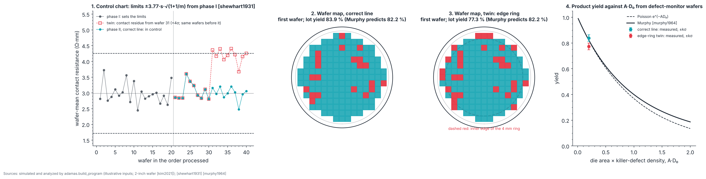

# P7 · Pilot line and products: statistical control and yield

_Generated from `adamas/build_program.py` (`adamas build docs`); every number below is computed by the package._

**Status: written in full.** Budget: **$4.5 M to $45 M** (experiment D2's part list: planning estimates, not quotes). Gate verdict in simulation: **go**.

Every input is **illustrative** except where a source is cited: the wafer is 2 inches, the size of published heteroepitaxial single-crystal diamond wafers [kim2021] [qu2024] (one 92 mm plate has been grown [schreck2017]; 3-inch wafers are an industry announcement without published data [e6orbray2026]); the die is the 3 mm PDK-0 monitor die (`adamas.pdk0`). The contact resistance is P4's illustrative value. The process spread, the defect density and both faults are chosen to look like a typical line, not measured. The phase is **simulated**: no diamond pilot line runs PDK-0 today, so the whole phase is **proposed**.

## Goal

Run the PDK-0 flow on many wafers in a row and show two things a pilot line needs before any product: that the process is **stable** (a monitor-die parameter stays inside control limits wafer after wafer) and that its **yield is understood** (the fraction of working dies is what its counted killer defects predict). Then rank products by good dies per wafer, which with a wafer cost gives the cost per good die.

## Physics and equations

- **Control chart:** each wafer's mean contact resistance R_c (from the transfer-length method, TLM, on the monitor die, as in P4) is plotted in processing order. Shewhart's chart [shewhart1931] flags a wafer outside mean ± 3σ, which a stable process does on 0.27 % of points. Here 20 wafers (phase I) set the limits and the next 20 (phase II) are judged. To keep the whole phase II run's false-alarm rate at most 1 − 97.47 %, each point gets α = 1 − 0.9747^(1/20) = 1.28e-03, and because the limits are estimated from m = 20 wafers they are a prediction interval: mean ± t·s·√(1 + 1/m) with the Student t quantile for m − 1 degrees of freedom, t = 3.77. The judged wafers share the estimated limits, so they are positively dependent and the run's false-alarm rate is at most the design (Šidák and Kimball inequalities); simulated it is about 2.3 %. Pass when no phase II wafer is outside. Assumes independent, normally distributed wafer means; wider limits than Shewhart's catch large shifts quickly but small drifts slowly.
- **Yield:** a die works when it carries no killer defect. If killer defects fall at random with density D, a die of area A works with probability e^(−AD) (Poisson). Densities vary across a wafer and between wafers; Murphy took a triangular distribution of D on [0, 2D₀] and found Y = [(1 − e^(−AD₀))/(AD₀)]² [murphy1964]; Stapper's clustered models generalize this [stapper1983] (`adamas.wafer`). D₀ is measured by inspecting every site of 10 defect-monitor wafers that run the same steps (1610 sites, killer defects only); electrical test counts the working product dies. Pass when the product yield agrees with Murphy's prediction from that D₀ within k = 2.24 standard errors (two-sided), with σ² = Y(1 − Y)/n + (Y′σ_D₀)² for the two independent samples (σ_D₀ from the spread of the per-site counts). At A·D₀ = 0.20 the Poisson and Murphy yields differ by only 0.3 percentage points, less than σ, so this check tests whether the measured defect density explains the yield (or a systematic loss adds to it), not which model is right; telling the models apart needs larger dies.
- **Cost per good die:** gross dies per wafer N = π(d/2)²/A − πd/√(2A) (the edge-loss approximation of `adamas.wafer`, with d the usable diameter) times the yield gives the good dies; the wafer's cost divided by that number is the cost per good die. No wafer cost is sourced yet, so this page gives the good dies, not the cost.

## Machines and facility

Atlas machines for this phase: M01 Microwave plasma chemical vapor deposition (MPCVD) reactor, M03 Heteroepitaxy stack deposition (iridium on yttria-stabilized zirconia (YSZ)/Si or sapphire, bias-enhanced nucleation), M05 Lapping, polishing, scaife or chemo-mechanical polishing, M06 Raman mapping, M07 X-ray diffraction (XRD) rocking curves and topography, M09 Defect inspection (birefringence, etch-pit counting), M16 Inductively coupled plasma reactive-ion etching (ICP-RIE), M17 Probe station, hot chuck, semiconductor parameter analyzer, M18 High-voltage curve tracer for breakdown, M23 Secondary-ion mass spectrometry (SIMS), plus every P4 machine for the device flow. Experiment D2 lists the line: mpcvd reactors (Wafer-scale growth); lithography and deposition (Steppers, e-beam, evaporators, ALD, etchers); metrology (Defect inspection, Raman mapping, probe cards); wafers (3-inch single-crystal, per year). A fab or a consortium pilot line, not a university cleanroom.

| Part (D2) | What | Price range (estimate) |
|---|---|---|
| MPCVD reactors | Wafer-scale growth | $1 M to $10 M |
| Lithography and deposition | Steppers, e-beam, evaporators, atomic layer deposition (ALD), etchers | $2 M to $20 M |
| Metrology | Defect inspection, Raman mapping, probe cards | $1 M to $10 M |
| Wafers | 3-inch single-crystal, per year | $0.5 M to $5 M |

D2 budgets 3-inch wafers; this page simulates 2-inch wafers, the largest size with published quality data in this repository's sources, so the wafer line is an upper estimate for it.

## Facility and safety

A pilot line needs a full semiconductor-fab environmental health and safety (EHS) program. Hydrogen and methane are flammable: leak-checked lines, gas detectors, interlocked exhaust. Microwave leakage check after any maintenance. Hot chuck burns; high-voltage breakdown tests only behind shields. Each hazardous process needs your institution's or company's specific training and sign-off before first use; this page does not replace that training.

## Procedure

1. **Baseline.** Run the PDK-0 traveler on 20 wafers without changing recipes; measure the monitor die on each (S17) and set the control limits.
2. **Monitor.** Keep running; plot every new wafer on the chart before releasing it. A point outside the limits stops the line until its cause is found.
3. **Inspect and test.** Map killer defects on every site of the defect-monitor wafers (birefringence, etch pits, optical inspection; Atlas M09) and test every product die electrically.
4. **Compare.** Predict the yield from the counted killer defects with Murphy's model and compare with the measured yield. Map where the failing dies are: a pattern (edge, centre, a quadrant) means a systematic cause, not random defects.
5. **Rank products** by good dies per wafer at your D₀ and die size, then by cost per good die once wafer costs are known.

## Expected results (simulated)

Each test is shown with its **degraded twin**: the same simulation with one fault, which the test must catch.

## Pass/fail

The gate needs both checks to pass, so each is set for 97.47 % coverage. Rates are over 1000 simulated runs (binomial standard error at the design rate: 0.5 percentage points per check, 0.7 for the gate).

| Check | Criterion | Put in | Measured | Pass? | Correct runs passing |
|---|---|---|---|---|---|
| Process in control | no phase II wafer outside mean ± 3.77·s·√(1+1/m) | R_c 3 ± 0.3 Ω·mm per wafer | limits 1.72 to 4.25 Ω·mm; 0 wafers outside | yes | 97.4 % |
| Yield explained by killer defects | \|Y − Y_Murphy(D₀)\| ≤ kσ | D₀ = 2 cm⁻² | D₀ = 2.21 ± 0.13 cm⁻² (monitors); Y = 83.9 % against 82.2 % predicted (σ 1.11 points), 3220 product dies | yes | 98.0 % |
| **Gate: every row passes** | | | | **yes** | **95.4 %** |

The degraded twins, one fault each. The last column is how often the faulty run wrongly passes.

| Test | Fault | Measured | Pass? | Faulty runs passing |
|---|---|---|---|---|
| Control chart | contact residue raises R_c by 4σ from wafer 31 (illustrative) | 4 wafers outside; first alarm at wafer 31 | no | 1.9 % |
| Yield | non-uniform growth near the edge: dies within 4 mm of the edge exclusion fail half the time (illustrative) | Y = 77.3 % against 82.2 % predicted; edge ring 43.8 %, centre 83.2 % | no | 0.0 % |

Against the 97.47 % design per check: the control-chart check passes correct runs about as often as designed (97.4 %); the yield check passes correct runs about as often as designed (98.0 %). Here a correct run sits exactly on the model each check tests (a stable process; a yield set by random killer defects), so its pass rate is the check's coverage: at least the design for the chart (slightly conservative, because the judged wafers share the estimated limits) and the design for large samples for the yield check (normal approximation). Over 1000 runs the gate passes 95.4 % of correct runs, consistent with the 95 % it is designed for. The chart's twin shifts by 4σ because limits this wide catch a 1σ drift only slowly; small drifts need a cumulative-sum or moving-average chart (not yet simulated).

## Products: good dies per 2-inch wafer

At the measured D₀ = 2.21 cm⁻², usable diameter 47 mm. Gross dies come from the edge-loss formula; the simulated wafer's square grid fits 161 whole 3 mm dies, close to the formula's 157.

| Die area (mm²) | Gross dies | Murphy yield | Good dies |
|---|---|---|---|
| 1 | 1630 | 97.8 % | 1594 |
| 9 | 157 | 82.2 % | 129 |
| 25 | 48 | 59.1 % | 28 |
| 100 | 6 | 16.2 % | 1 |

Yield falls steeply with die area, so at this D₀ small dies (sensors, discrete switches) get by far the most good dies per wafer, and large dies (qubit arrays, large power switches) need a lower D₀. Which product pays for the line also needs each product's price and test cost, which are not sourced ([STATUS.md](../STATUS.md)).

## Not yet simulated

- **Spatially clustered defects:** each die's density is drawn independently; real defects cluster (Stapper's negative-binomial model [stapper1983]), which raises yield at a given D₀ and widens wafer-to-wafer spread.
- **Small drifts:** cumulative-sum (CUSUM) or exponentially weighted moving-average (EWMA) charts.
- **Several parameters at once:** only R_c is charted; a line charts every traveler check (threshold, sheet resistance, leakage, NV yield).
- **Defect density's effect on leakage and coherence:** dislocation densities by substrate class are in `adamas.wafer`, but no model links them to leakage current or T₂ yet.
- **Product qualification:** reliability tests per product (temperature, humidity, high-voltage life) need sourced criteria.

## Failure modes

- **Out-of-control point:** a recipe, chamber or source-gas change; stop, find the cause, and decide whether the wafers since the last good point are usable.
- **Yield below prediction:** a systematic loss (edge ring, a bad mask area, a probe-card fault); look at where failing dies sit on the map.
- **Yield above prediction:** the inspection counts defects that do not kill, or the monitor wafers see more defects than the product wafers; recalibrate which defect classes are killers against electrical test.
- **D₀ too high for the product:** grow on lower-dislocation substrates (homoepitaxial on high-pressure high-temperature, HPHT, seeds) or reduce particles; compare substrate classes in `adamas.wafer`.

## Decision gate

*Which product line pays for the line?* Both simulated checks pass and both degraded twins fail, so the analysis can tell a stable, defect-limited line from a drifting or edge-limited one; the gate is decided by the numbers measured on your line. The simulation can rank products by good dies per wafer, which favours small dies; the economic answer needs sourced wafer, test and product prices. Go to P8 when one product's measured cost per good die is below its price.

Sources: [kim2021] [qu2024] [schreck2017] [e6orbray2026] [shewhart1931] [murphy1964] [stapper1983]
