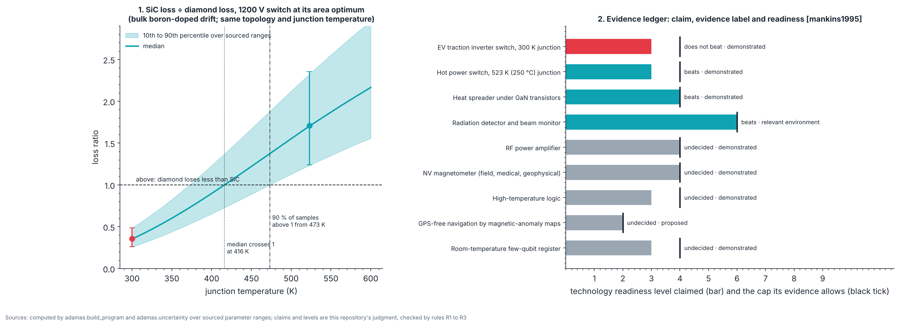

# P8 · Frontier: where diamond beats the incumbent, with evidence

_Generated from `adamas/build_program.py` (`adamas build docs`); every number below is computed by the package._

**Status: written in full.** Budget: **not priced** (application-specific test benches, shielded rooms and irradiation facilities; no sourced prices). Gate verdict: **go**.

P8 is not one experiment. It asks, application by application, whether diamond beats the device it would replace, and answers with an **evidence ledger** whose rules are evaluated by code, so an inflated claim fails the build the way a failed measurement fails the earlier phases. Claims and readiness levels are this repository's judgment; the rules check them against the evidence. Nothing here is a new measurement: the comparisons are **simulated** over sourced parameter ranges, and every result is labeled with the evidence behind it.

## Goal

For each application in the outline (grid and electric-vehicle power, hot and harsh-environment electronics, radiation detection, medical and field magnetometry, navigation, room-temperature quantum registers): name the incumbent, compare where a comparison can be computed or is published, assign a technology readiness level (TRL) no higher than the evidence allows, and name the key unsolved problem. Terms in the ledger: EV, electric vehicle; MOSFET, metal-oxide-semiconductor field-effect transistor (FET); GaN, gallium nitride; RF, radio frequency; NV, nitrogen-vacancy center; SQUID, superconducting quantum interference device; GPS, Global Positioning System.

## Rules (evaluated by code)

- **R1 Claim follows evidence.** "Beats" or "does not beat" needs either a computed comparison that is decisive over the sourced parameter ranges (its 10th percentile above 1, or its 90th below 1) or a cited measured comparison. A claim may not contradict a decisive computed comparison: no hiding a loss, and no hiding a win. Otherwise the claim is "undecided".
- **R2 Readiness follows evidence.** TRL follows the NASA scale [mankins1995]; the cap is set by the strongest cited evidence: proposed ≤ 2, simulated ≤ 3, demonstrated in a lab ≤ 4, operated in a relevant environment ≤ 6, commercial ≤ 9.
- **R3 Name the problem.** Every application states its key unsolved problem.

## Physics and equations

- **Power switch loss:** at the area that minimizes conduction plus switching loss, a switch's loss scales as √(R_on,sp · C_oss,sp), so the ratio of silicon carbide's loss to diamond's is √[(R·C)_SiC / (R·C)_diamond] for a 1200 V device (`adamas.uncertainty.power_ratio`, `adamas.converter`). R_on includes the lattice mobility at the junction temperature and, for diamond's bulk boron-doped drift region, the ionized fraction of the boron, which is small at room temperature and grows with temperature. Parameter ranges (Latin-hypercube sampled, 2000 samples): Diamond critical field 5 to 10 MV/cm [wort2008] [donato2020]; Diamond hole mobility 1000 to 3800 cm²/V·s [sanders2021] [volpe2009] [isberg2002]; Diamond permittivity 5.6 to 5.8 [sze2006]; SiC critical field 2.2 to 3 MV/cm [kimoto2014]; SiC electron mobility 700 to 1000 cm²/V·s [kimoto2014]. Assumes the same converter topology and thermal design and ignores packaging, gate drive and reliability.
- **Result:** at 300 K the ratio is 0.26 to 0.49 (10th to 90th percentile): diamond **loses**. At 523 K it is 1.24 to 2.35: diamond **wins**. The median crosses 1 at 416 K and 90 % of the samples are above 1 from 473 K. So the computed case for a diamond power switch is a hot one, not a room-temperature one, for this drift-region design.
- **Heat spreading:** thermal conductivity, diamond 4.5 times silicon carbide's (`adamas.materials`, point values).
- **Readiness:** TRL 1 to 9 [mankins1995]: 1 basic principles observed; 2 concept formulated; 3 proof of concept; 4 component validated in the lab; 5 component validated in a relevant environment; 6 prototype in a relevant environment; 7 prototype in an operational environment; 8 system complete and qualified; 9 system proven in operation.

## Evidence ledger

| Application | Incumbent | Metric | Comparison (above 1 favours diamond) | Claim | Evidence | TRL | Rules pass? |
|---|---|---|---|---|---|---|---|
| EV traction inverter switch, 300 K junction | silicon carbide MOSFET [reimers2019] | switch loss at the area optimum | 0.26 to 0.49 (median 0.36) | **does not beat** | demonstrated: 3.66 kV diamond MOSFETs on heteroepitaxial wafers [saha2023] | 3 (cap 4) | yes |
| Hot power switch, 523 K (250 °C) junction | silicon carbide MOSFET at the same junction temperature | switch loss at the area optimum | 1.24 to 2.35 (median 1.71) | **beats** | demonstrated: hydrogen-terminated diamond FETs operating at 400 °C and 500 V [kawarada2014] | 3 (cap 4) | yes |
| Heat spreader under GaN transistors | silicon carbide substrate | thermal conductivity | 4.49 (point values; no range sourced) | **beats** | demonstrated: 4-inch GaN-on-diamond substrates [francis2010] | 4 (cap 4) | yes |
| Radiation detector and beam monitor | silicon detector | radiation hardness | diamond detectors tolerate higher radiation doses than silicon ones [tapper2000] | **beats** | relevant environment: detectors operated in particle-physics experiments [tapper2000] | 6 (cap 6) | yes |
| RF power amplifier | GaN transistor | output power density | none sourced | **undecided** | demonstrated: 3.8 W/mm at saturation velocity [imanishi2019] | 4 (cap 4) | yes |
| NV magnetometer (field, medical, geophysical) | fluxgate, optically pumped or SQUID magnetometers | sensitivity at room temperature | none sourced | **undecided** | demonstrated: compact nanotesla-sensitivity NV magnetometer [webb2019]; sensitivity limits reviewed in [barry2020] | 4 (cap 4) | yes |
| High-temperature logic | silicon carbide and silicon-on-insulator logic [watson2015] | gates working at temperature | none sourced | **undecided** | demonstrated: logic gates from hydrogen-terminated diamond FETs [liu2017] | 3 (cap 4) | yes |
| GPS-free navigation by magnetic-anomaly maps | inertial navigation with fluxgate or optically pumped magnetometers | position error over time | none sourced | **undecided** | proposed: no diamond navigation result is sourced here | 2 (cap 2) | yes |
| Room-temperature few-qubit register | superconducting and trapped-ion processors (no comparison is made) | none: this program does not claim parity | none sourced | **undecided** | demonstrated: two-NV entanglement at room temperature [dolde2013] | 3 (cap 4) | yes |

## Machines and facility

Atlas machines for this phase: M56 Converter test bench (double-pulse tester, power analyzer, thermal camera), M57 Irradiation access (gamma, proton), M58 Magnetically shielded room or gradiometer setup, M59 Navigation test platform with a magnetic-anomaly map. Each application needs its own facility: a converter test bench, a magnetically shielded room, an irradiation facility, a vehicle with a magnetic-anomaly map.

## Facility and safety

High-voltage converter tests run behind interlocked shields; irradiation is done only at licensed facilities under their radiation-safety program; lasers for NV magnetometers are Class 3B or 4. Each needs your institution's specific training and sign-off before first use; this page does not replace that training.

## Procedure

1. **For each application,** find the incumbent's number for the metric that matters, from a source.
2. **Compute** the comparison where a model exists, over sourced parameter ranges, or **cite** a measured one.
3. **Assign** the TRL from the strongest evidence, not from the hope.
4. **Run the rules** (`adamas build docs` does it); fix the claim, not the rule, when one fails.
5. **Test** the leading application on its bench (M56 for power) to turn a computed comparison into a measured one.

## Expected results

## Pass/fail

The gate passes when every ledger row passes R1 to R3. The rules are deterministic, so there is no pass rate; instead each rule is tested on a **degraded twin**: an inflated claim that it must reject.

| Twin | Fault | Why it must fail | Rule | Passes? |
|---|---|---|---|---|
| Hide a loss | claims the 300 K inverter switch **beats** SiC | computed ratio 0.26 to 0.49, decisively below 1 | R1 | no |
| Inflate readiness | gives the NV magnetometer TRL 6 | its evidence is a lab demonstration, cap 4 | R2 | no |
| Unsupported win | claims the RF amplifier **beats** GaN | no computed or cited comparison | R1 | no |

## Key unsolved problems

- **EV traction inverter switch, 300 K junction:** boron is only partly ionized at room temperature, so a bulk-doped drift region has a high resistance; a drift region that avoids it is not demonstrated.
- **Hot power switch, 523 K (250 °C) junction:** no diamond converter has run at this temperature; gate insulator, contacts and package must survive it for years.
- **Heat spreader under GaN transistors:** the thermal boundary resistance at the GaN–diamond interface and wafer bow limit the gain.
- **Radiation detector and beam monitor:** charge-collection distance of polycrystalline material and the cost of single-crystal plates.
- **RF power amplifier:** no like-for-like comparison with GaN at the same frequency and efficiency is sourced here; surface-conductivity stability.
- **NV magnetometer (field, medical, geophysical):** medical use (brain and heart signals) needs femtotesla-level sensitivity; no sourced requirement or incumbent number is in this repository yet.
- **High-temperature logic:** only p-type FETs are mature, so complementary logic and its static power are open.
- **GPS-free navigation by magnetic-anomaly maps:** a vector magnetometer with sourced sensitivity, drift and vehicle-noise rejection; anomaly-map resolution.
- **Room-temperature few-qubit register:** coupling more than a few spins with high fidelity; readout time (P3 to P6 of this program).

## Not yet sourced

- Incumbent numbers for magnetometry (femtotesla-level medical requirements, fluxgate and optically pumped sensitivities) and for GaN RF power density at matched conditions.
- Any diamond navigation result, and a magnetic-anomaly navigation requirement.
- Radiation-hardness numbers (dose to failure) for diamond and silicon devices, beyond the review [tapper2000].
- Prices of the test benches, shielded rooms and irradiation time.

## Failure modes

- **A model comparison taken for a measurement:** the loss ratio is simulated; only a bench measurement (M56) at matched junction temperature makes it evidence of the next level.
- **Unfair comparisons:** an incumbent at a worse operating point, a different topology, or a cherry-picked parameter; the ranges here are sourced and sampled, not chosen.
- **Readiness drift:** levels raised by enthusiasm; rule R2 stops that in this repository.

## Decision gate

*Where does diamond beat the incumbent, with evidence?* With the evidence in this repository, the rows that claim a win and pass the rules are: hot power switch, 523 k (250 °c) junction, heat spreader under gan transistors, radiation detector and beam monitor. The hot power switch's win is computed, not measured: P4 to P7 devices tested on the converter bench at 250 °C would make it a measurement. Everywhere else the honest answer is "does not beat" or "undecided", and the key problem above says what would change it.

Sources: [mankins1995] [wort2008] [donato2020] [sanders2021] [volpe2009] [isberg2002] [sze2006] [kimoto2014] [reimers2019] [saha2023] [kawarada2014] [francis2010] [tapper2000] [imanishi2019] [webb2019] [barry2020] [watson2015] [liu2017] [dolde2013]
