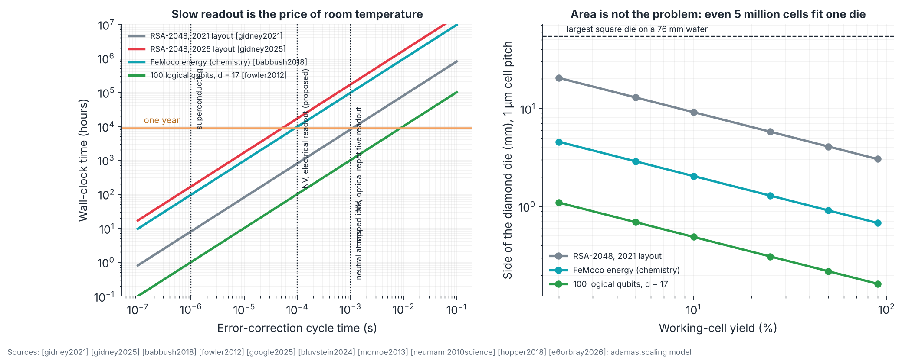
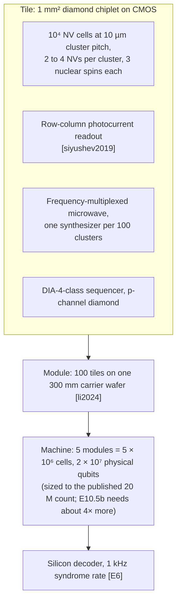
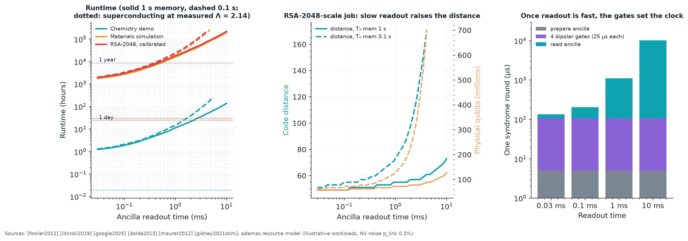
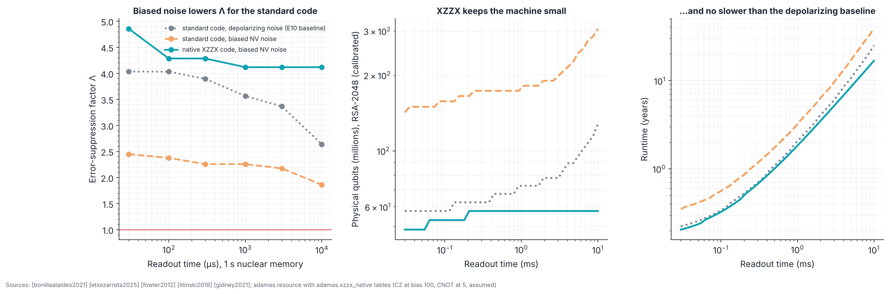
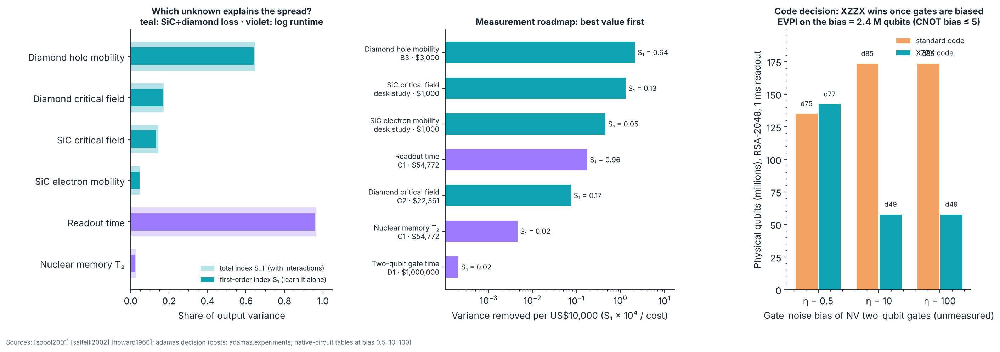

# E10 · Sizing a scalable room-temperature quantum computer

**Plain-language summary.** Chapters 8 and E6 said what one cell can do and how many cells a logical qubit needs. This chapter asks the blunt questions: how big a diamond chip, how many wafers, how much power, and how long would known algorithms take? The answers say what a room-temperature diamond machine is for.

Code: `adamas.scaling`, `adamas.surface_sim`, `adamas.qec`.

## E10.1 Workloads people actually want

| Task | Physical qubits (surface code, 10⁻³ error) | Time at a 1 µs cycle | Source |
|---|---|---|---|
| Factor RSA-2048 (2021 layout) | 20 million | 8 hours (with a 10 µs reaction time, distance 27) | [gidney2021] |
| Factor RSA-2048 (2025 layout) | under 1 million | about a week | [gidney2025] |
| FeMoco nitrogenase ground-state energy | about 1 million | days | [reiher2017], [babbush2018] |
| 100 logical qubits at distance 17 | 57,700 | (memory) | [fowler2012] |

Layout theory: [litinski2019]. Current best hardware: below-threshold surface code on 105 superconducting qubits [google2025] (see also [google2023], [arute2019], [kjaergaard2020]), logical processors on neutral atoms [bluvstein2024], ion traps [monroe2013].

## E10.2 Time: the room-temperature penalty

The error-correction cycle is limited by readout. Superconducting qubits read out in about 1 µs; an NV electron read by repetitive nuclear-assisted readout takes 0.1 to 10 ms ([neumann2010science], [hopper2018]). Wall-clock time scales with the cycle:

| Cycle time | RSA-2048 (2021 layout) | 100-logical-qubit job of 1 hour at 1 µs |
|---|---|---|
| 1 µs (superconducting) | 8 hours | 1 hour |
| 100 µs (NV, electrical readout, proposed) | 33 days | 4 days |
| 1 ms (NV, optical repetitive readout) | about 0.9 years | 42 days |

These rows only stretch the published schedule (the scaling model, `adamas.scaling`). The circuit-level model of Section E10.5b also lets slow readout raise the code distance and gives **2.1 years** for RSA-2048 at 1 ms readout. Both are quoted below with their names; neither is a measurement.

**Conclusion.** A room-temperature NV machine is a poor factoring engine and a poor general-purpose accelerator for deep circuits. That is not a defect to hide; it is a design input. The workloads that fit are those where slow, long-lived, cryostat-free qubits win: quantum memories and repeaters at the network edge, sensing-coupled computation, small variational or sampling tasks [peruzzo2014], [preskill2018], and embedded deployments ([qbpawsey2023], [olcf2025]).

## E10.3 Area: not the constraint

At a 1 µm cell pitch, 60 percent fill, 4 qubits per cell, `adamas.scaling` gives:

| Task | NV cells | Die side (mm) at 100% yield | at 10% yield | Fraction of one 76 mm wafer |
|---|---|---|---|---|
| RSA-2048 (2021) | 5,000,000 | 2.9 | 9.1 | < 2% |
| FeMoco | 250,000 | 0.65 | 2.0 | < 0.1% |
| 100 logical qubits | 14,425 | 0.16 | 0.5 | ≈ 0 |

Even the largest published workload fits on one die. The binding constraints are **yield of working cells** ([Chapter 7](../07_nv_fabrication_and_placement.md)) and **control wiring**, not diamond area. Compare superconducting hardware, where wiring and cryostat capacity dominate scaling ([krinner2019], [reilly2015], [vandersypen2017], [vandijk2019]).

## E10.4 Control and power

Per driven cell: about 1 mW of microwave and 0.1 to 1 mW of green light. With 10 percent of cells active per cycle, a 5-million-cell machine draws about 650 W of qubit-side power and no cryostat, against tens of kilowatts for a dilution refrigerator plus its electronics [krinner2019]. Multiplexing is mandatory: a million individually wired microwave lines is not buildable, so the architecture needs frequency addressing within clusters ([Chapter 9](../09_cmos_control_integration.md)), row-column electrode selection for electrical readout ([siyushev2019]), and the DIA-4-class on-diamond sequencers of [E3](E3_digital_and_cpu_design.md) as local controllers.

## E10.5 A reference machine (proposal)

Requirements this machine imposes, in order of difficulty: an inter-cell link (not yet demonstrated; Section E10.5b) with error at or below the 0.3 percent assumed in E10.5b, against a circuit-level threshold of about 1 percent ([E6](E6_error_correction_and_system_architecture.md)); cluster yield above 10 percent with detect-and-repair ([Chapter 11](../11_proposed_experiments_and_roadmap.md), C-5); ancilla readout below about 1% of the nuclear-memory coherence time ([E6](E6_error_correction_and_system_architecture.md), Section E6.1c; electrical readout at about 100 µs meets it even for a 0.1 s memory); and 1 µm-pitch qubit lithography ([E1](E1_lithography_from_euv_to_electron_beam.md)).

## E10.5b From circuit-level error rates to a machine (project X-2, done; revised in v0.27)

Sections E10.2 to E10.5 scaled published physical-qubit counts. `adamas.resource` instead derives the machine from the bottom up. It fits the circuit-level logical error of [E6](E6_error_correction_and_system_architecture.md) (Section E6.1c) to the standard form $p_L(d) = A\,\Lambda^{-(d+1)/2}$ for every readout time and memory lifetime; picks the smallest odd distance with $n_L \cdot D \cdot d \cdot p_L(d) \le 1\%$ for $n_L$ logical qubits and $D$ logical steps of $d$ rounds each ([litinski2019]); and prices one round as ancilla preparation (5 µs) plus four inter-cell gates plus readout. Routing and magic-state factories double the patch count.

**Two assumptions to name.**

- *The inter-cell link.* Cells sit on a 1 µm pitch, set by optical addressing and wiring. A direct dipolar gate at 1 µm would take about 10 s (the coupling is about 0.05 Hz), thousands of times the electron coherence time. The model therefore assumes a mediated link between neighbouring cells, a spin-chain bus or a photonic link, with the time and error of a 25 nm double-quantum dipolar gate: 25 µs ([dolde2013], [E5](E5_nv_qubit_engineering.md)) and 0.3 % (`resource.LINK`). No such link has been demonstrated at room temperature (proposed here). The alternative, all cells at 25 nm, needs the addressing methods of [Chapter 8](../08_quantum_processor_architecture.md).
- *The RSA-2048 step count.* Its logical step count $D$ is calibrated so that the published parameters of [gidney2021] (distance 27, 1 µs cycle) give their published 8 hours: $D = 8\,\text{h} / (27 \times 1\,\mu s) = 1.07 \times 10^9$, with 6,000 logical qubits (their $3n + 0.002\,n \lg n$ data register). Earlier versions used $3 \times 10^9$, the Toffoli count, as serial steps; that overstates the published runtime about threefold and is kept as an upper bound.

| Job | Readout | Memory T₂ | Distance | Physical qubits | Die side | Round | Runtime | Superconducting, today's measured Λ = 2.14 |
|---|---|---|---|---|---|---|---|---|
| Chemistry demo (100 logical, 10⁶ steps) | 0.1 ms | 1 s | 33 | 0.4 M | 0.4 mm | 205 µs | 2 h | 1 min (d = 63) |
| Chemistry demo | 1 ms | 1 s | 37 | 0.5 M | 0.5 mm | 1105 µs | 11 h | 1 min (d = 63) |
| Chemistry demo | 1 ms | 0.1 s | 49 | 1.0 M | 0.6 mm | 1105 µs | 15 h | 1 min (d = 63) |
| Materials simulation (1,000 logical, 10⁹ steps) | 0.1 ms | 1 s | 47 | 8.8 M | 1.9 mm | 205 µs | 112 days | 27 h (d = 87) |
| Materials simulation | 1 ms | 1 s | 51 | 10.4 M | 2.1 mm | 1105 µs | 1.8 years | 27 h (d = 87) |
| Materials simulation | 1 ms | 0.1 s | 69 | 19.0 M | 2.8 mm | 1105 µs | 2.4 years | 27 h (d = 87) |
| RSA-2048, calibrated (6,000 logical, 1.07 × 10⁹ steps) | 0.1 ms | 1 s | 49 | 57.6 M | 4.9 mm | 205 µs | 124 days | 30 h (d = 93) |
| RSA-2048, calibrated | 1 ms | 1 s | 55 | 72.6 M | 5.5 mm | 1105 µs | **2.1 years** | 30 h (d = 93) |
| RSA-2048, calibrated | 1 ms | 0.1 s | 73 | 127.9 M | 7.3 mm | 1105 µs | 2.7 years | 30 h (d = 93) |
| RSA-2048, upper bound (3 × 10⁹ serial steps) | 1 ms | 1 s | 57 | 78.0 M | 5.7 mm | 1105 µs | 6.0 years | — |

The last column uses the same bookkeeping with the measured below-threshold factor Λ = 2.14 and a 1.1 µs cycle [google2025]. It is not the 8 hours of [gidney2021], which assumes the error rates of their paper (10⁻³ physical error, distance 27).

Three findings follow.

1. **Area stays small, time does not.** Even the RSA-2048 job fits on a diamond die under 8 mm on a side, but it runs for about two years at millisecond readout, against about 30 hours on a superconducting machine with today's measured error suppression.
2. **Slow readout costs twice.** It lengthens every round, and through the idle errors of Section E6.1c it lowers Λ, which raises the distance, which multiplies both qubit count and runtime. With a 0.1 s memory and 1 ms readout, the RSA distance rises from 55 to 73.
3. **Fast readout moves the bottleneck to the link.** At 0.1 ms readout, four 25 µs link operations are half of every round, so the link's speed, not readout, is the next lever.

The asymmetry must be stated: the NV numbers assume a 0.3 % link error and a link that does not exist yet, far better than the best demonstrated room-temperature NV–NV entangling fidelity ([dolde2014]; [Chapter 8](../08_quantum_processor_architecture.md) has the current record), while the superconducting column uses a measured Λ. The comparison therefore shows what NV hardware would need, not what it has. The interactive version is the [Machine Builder](https://normansrule.github.io/adamas-diamond-framework/labs/machine.html).

## E10.5c The code choice matters if the noise is biased (project X-5, applied)

E10.5b used the standard surface code with depolarizing noise. Chapter E6.1e showed that if NV gate errors are dominated by dephasing, the XZZX code gains, provided the gates keep the bias. With two-level qubits only CZ gates can; CNOTs keep at most η ≈ 5 [etxezarreta2025]. The resource tables were rebuilt with the CZ-native circuits of `adamas.xzzx_native`: CZ gates at bias η = 100 and CNOTs at 5 (assumptions: the bias of NV two-qubit gates has not been measured), 0.3 % gate error, 1 % readout, 0.2 % preparation, and pure dephasing during readout (100,000 shots per point, worse memory basis). Same RSA-2048 job, 1 ms readout, 1 s memory:

| Code and noise model | Λ at 1 ms | Distance | Physical qubits | Die side | Runtime |
|---|---|---|---|---|---|
| standard code, depolarizing gate and idle noise (E10.5b) | 3.56 | 55 | 73 M | 5.5 mm | 2.1 years |
| standard code, biased NV noise (CZ at bias 100, CNOT at 5, dephasing idle) | 2.26 | 85 | 173 M | 8.5 mm | 3.2 years |
| native XZZX code, same biased NV noise | 4.12 | 49 | 58 M | 4.9 mm | 1.8 years |

**Reading the table.** Compare codes within one noise model. Under biased NV noise the standard code needs **3.0×** the qubits of the XZZX code (173 M against 58 M) and 1.7× the time. The first row uses a different noise model (a two-qubit depolarizing channel, about half the error per gate of the native tables) and is a baseline, not a comparison. Before v0.27 this section reported 399 M against 67 M, from tables that gave CNOTs the full bias and ran the Z ancillas in the Z frame; those numbers are withdrawn. The Machine Builder lab has a selector for all three models.

## E10.5d What to measure next (decision analysis)

E10.5c raised a question it did not answer: if the bias of NV two-qubit gates decides which code to run, how much is measuring it worth? `adamas.decision` answers that and its broader cousin, which unknown in the whole framework is worth measuring first.

**Variance-based sensitivity.** The tornado of Figure 49 moves one input at a time. Sobol indices [sobol2001] instead ask what share of the output variance each input explains when all inputs vary together. The first-order index S₁ of an input is exactly the fraction of the variance that would disappear, on average, if that input were known perfectly; the total index S_T adds its interactions. They are estimated with the pick-freeze scheme of Saltelli and Jansen [saltelli2002] [jansen1999] on 16,000 Latin-hypercube samples (seed-to-seed scatter about ±0.02; the validation matrix checks the estimator against an exact case).

- **Power** (silicon-carbide-to-diamond inverter loss at 300 K, bulk-doped drift): diamond's hole mobility explains most of the spread (S₁ ≈ 0.64), its critical field 0.17, silicon carbide's own parameters about 0.18. The field matters less than before v0.27 because a weakly ionized drift has $f_{ion} \approx \sqrt{K/N}$ with $N \propto E_c^2$, so the loss ratio goes as $\sqrt{\mu E_c}$ rather than $\sqrt{\mu}\,E_c$.
- **Quantum** (log runtime of the RSA-2048 job): readout time explains 96 % of the variance; every other input is at or near the estimator's resolution.

**Measurement roadmap.** Each input is mapped to the experiment that pins it down (costs are geometric means of the price ranges in [EXPERIMENTS.md](../experiments/EXPERIMENTS.md); desk studies are a nominal US$1,000), and ranked by variance removed per dollar:

| Rank | Input | Study | S₁ | How it is measured | Cost | S₁ per US$10k |
|---|---|---|---|---|---|---|
| 1 | Diamond hole mobility | power | 0.64 | B3 (Hall and four-point measurement on doped single-crystal diamond) | $3,000 | 2.133 |
| 2 | SiC critical field | power | 0.13 | desk study (literature review of commercial 4H-SiC) | $1,000 | 1.306 |
| 3 | SiC electron mobility | power | 0.05 | desk study (literature review of commercial 4H-SiC) | $1,000 | 0.456 |
| 4 | Readout time | quantum | 0.96 | C1 (single-shot readout on a single NV by photon counting or photocurrent) | $54,772 | 0.175 |
| 5 | Diamond critical field | power | 0.17 | C2 (breakdown of sacrificial devices from a traveler run) | $22,361 | 0.075 |
| 6 | Nuclear memory T₂ | quantum | 0.02 | C1 (nuclear-spin echo while the electron is read out) | $54,772 | 0.005 |
| 7 | Two-qubit gate time | quantum | 0.02 | D1 (dipolar coupling of implanted pairs) | $1,000,000 | 0.000 |

The cheapest high-value measurement in the framework is a **Hall measurement of hole mobility in doped single-crystal diamond** (experiment B3, a few thousand dollars), which addresses about two thirds of the uncertainty in the power case. Desk studies of silicon carbide rank high only because they are nearly free; they can narrow the range only as far as the literature agrees. On the quantum side, single-NV readout experiments (C1) dominate everything else by a wide margin.

**The code decision under unknown bias.** Native-circuit resource tables were built at gate-noise bias η = 0.5 (depolarizing gates), 10, and 100 on CZ, with CNOTs at min(η, 5), for both codes, always with dephasing idle errors during readout (RSA-2048 job, 1 ms readout, 1 s memory; entries are distance · physical qubits · runtime):

| Gate-noise bias on CZ | Standard code | XZZX code |
|---|---|---|
| η = 0.5 | 75 · 135 M · 2.8 yr | 77 · 142 M · 2.9 yr |
| η = 10 | 85 · 173 M · 3.2 yr | 49 · 58 M · 1.8 yr |
| η = 100 | 85 · 173 M · 3.2 yr | 49 · 58 M · 1.8 yr |

XZZX wins clearly once the gates are biased and nearly ties without bias (5 % more qubits, within one distance step). With a uniform prior over the three biases the expected value of perfect information on the bias [howard1966] is **2.4 M qubits** (about 3 % of the expected 86 M) and 0.02 years: choose XZZX, and measure the bias to size the machine, not to pick its code. Under XZZX the machine ranges from 58 M qubits (biased gates) to 142 M (unbiased gates). Before v0.27, when CNOTs were given the full bias, XZZX dominated at every bias and the EVPI was zero.

Caveats: these native tables put an independent single-qubit channel of probability p on each qubit after a two-qubit gate, about twice the error of the two-qubit depolarizing channel used in E10.5b, so their absolute numbers are more pessimistic than the E10.5b baseline; compare codes within one model, not across models. The prior over the bias (uniform over three values) is an assumption. Both codes use the same CZ-native gate set, so their hardware cost is the same.

## E10.6 Projects

| ID | Item | Deliverable |
|---|---|---|
| X-2 | Full resource estimate from circuit-level error rates | **Done in v0.13.0** (Section E10.5b, `adamas.resource`, Machine Builder lab) |
| X-3 | Multiplexing study: crosstalk versus number of clusters per synthesizer | Maximum multiplexing ratio at 10⁻³ gate error |
| X-4 | Compare with a cryogenic silicon-spin or superconducting machine of equal logical capacity on cost, power, and footprint | Decision matrix for which workloads justify room temperature |
