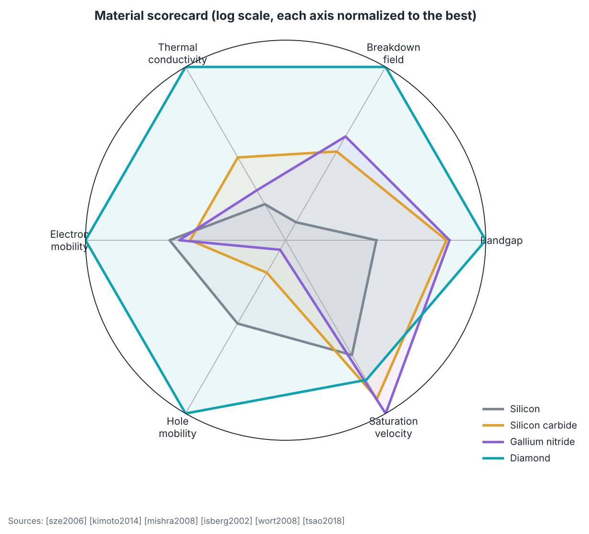
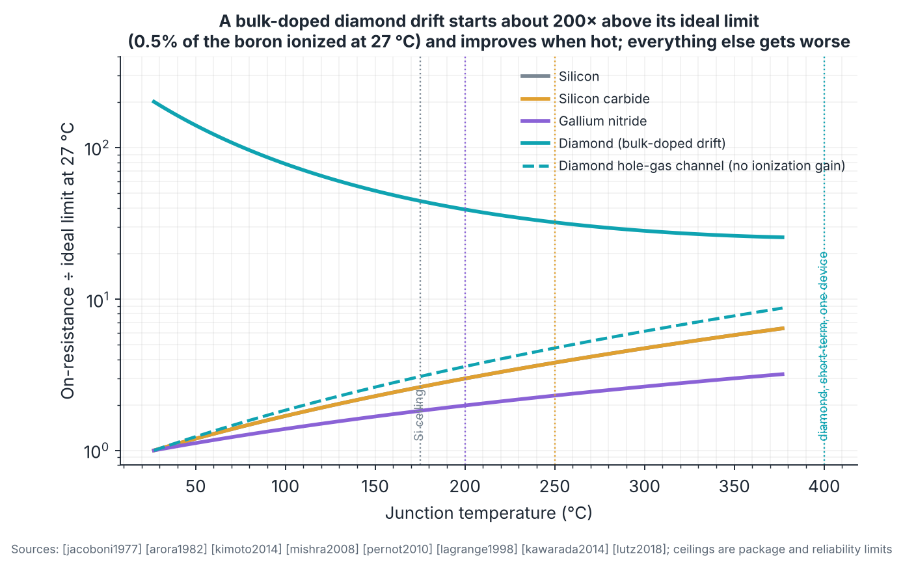
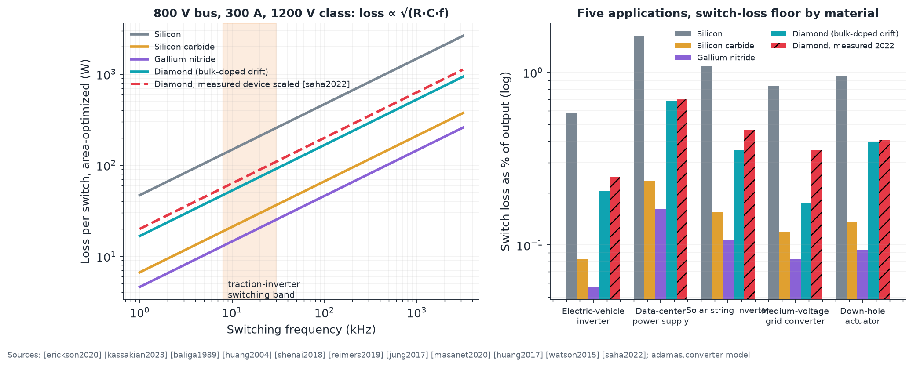
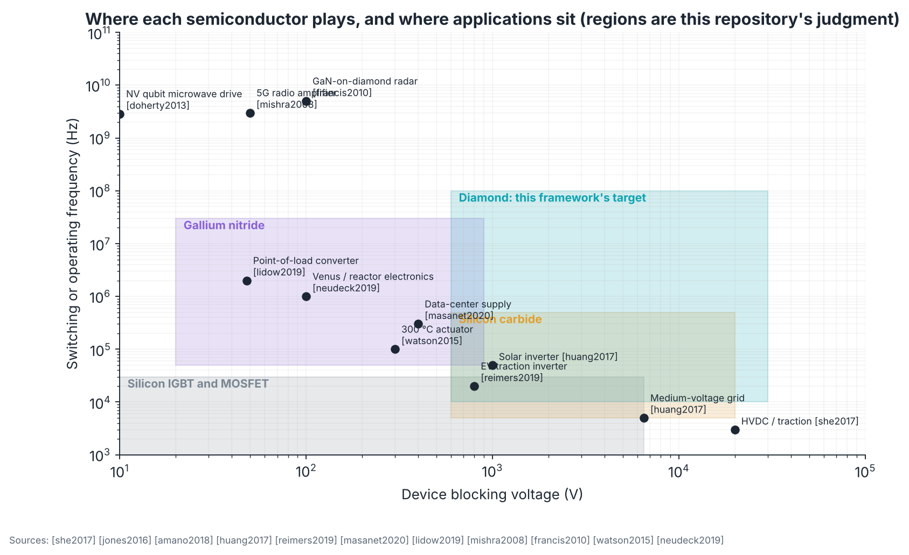

# E9 · Power circuits: diamond against silicon carbide and gallium nitride

**Plain-language summary.** Every electric car, solar inverter, and data center runs on power switches. Silicon dominated until about 2015; silicon carbide (SiC) now owns high-voltage traction, and gallium nitride (GaN) owns fast, lower-voltage converters. This chapter asks, application by application and with a tested loss model, where diamond would win against those two, and what has to happen first.

Code: `adamas.converter`. Textbooks: [baliga2019], [lutz2018], [erickson2020], [kassakian2023].

## E9.1 The incumbents

| | Silicon | Silicon carbide (4H) | Gallium nitride | Diamond |
|---|---|---|---|---|
| Commercial since | 1950s | Schottky 2001, MOSFET 2011 | 2010 | not yet |
| Wafer | 300 mm | 200 mm | 200 mm GaN-on-silicon | 2-inch (peer-reviewed) [kim2021]; 76 mm announced [e6orbray2026] |
| Best device class | IGBT to 6.5 kV | MOSFET 650 to 3300 V | HEMT 100 to 650 V | lateral MOSFET to 3659 V (lab) |
| Known weakness | Slow, hot | Gate-oxide reliability, cost | Dynamic on-resistance, no avalanche, vertical devices immature | Everything in [Chapter 3](../03_process_flow_vs_cmos.md) |
| Sources | [lutz2018] | [she2017], [kimoto2015], [palmour2014] | [jones2016], [chen2017gan], [amano2018], [lidow2019], [meneghini2021], [meneghesso2008], [uren2017], [flack2016] | [saha2023], [umezawa2018] |

Cross-technology reviews: [roccaforte2018], [millan2014], [hudgins2003], [tsao2018].

## E9.2 Temperature: the argument that is unique to diamond

**Headline: diamond wins when hot; a bulk-doped switch loses to SiC at room temperature.**

Every unipolar switch's resistance rises with temperature as lattice scattering lowers mobility, roughly as $T^{2.4}$ in silicon and SiC ([jacoboni1977], [arora1982], [kimoto2014]) and $T^{1.5}$ in a GaN electron gas [mishra2008]. In bulk boron-doped diamond the mobility falls faster still, about $T^{2.8}$ [pernot2010], but the deep 0.37 eV acceptors are mostly neutral at room temperature and ionize as the device heats [lagrange1998]. For a bulk boron-doped drift layer (`adamas.converter.ron_temperature_factor`, proposed here):

$$R_{on}(T) = R_{ideal}\left(\frac{T}{300\ \mathrm{K}}\right)^{\alpha} \frac{1}{f_{ion}(T)}$$

$R_{ideal}$ is the one-dimensional unipolar limit with every acceptor ionized and the 300 K mobility; $\alpha$ is the lattice-mobility exponent; $f_{ion}$ is the ionized fraction of the drift doping from `adamas.doping`. Assumptions: uncompensated boron (compensation lowers $f_{ion}$ further), doping fixed by the unipolar-limit design, no field-assisted ionization. A 1200 V drift needs about 1.3 × 10¹⁷ cm⁻³ boron, of which only 0.50 % is ionized at 300 K (`adamas.converter.drift_ionized_fraction`). For Si, SiC and GaN, $f_{ion}$ = 1. A hole-gas channel does not depend on bulk ionization and has no such gain.

| Junction temperature | Si | SiC | GaN | Diamond, bulk-doped 1200 V drift (boron ionized) |
|---|---|---|---|---|
| 27 °C (300 K) | 1.0× | 1.0× | 1.0× | 201× (0.50 %) |
| 127 °C (400 K) | 2.0× | 2.0× | 1.5× | 62× (3.6 %) |
| 227 °C (500 K) | 3.4× | 3.4× | 2.2× | 35× (12 %) |
| 250 °C (523 K) | 3.8× | 3.8× (at its package ceiling) | 2.3× (above 200 °C) | 32× (15 %) |
| 327 °C (600 K) | 5.3× (above its 175 °C ceiling) | 5.3× (above 250 °C) | 2.8× (above 200 °C) | 27× (26 %) |

Values are $R_{on}(T)/R_{ideal}$ of each material, computed by `adamas.converter`. Two consequences. Bulk-doped diamond is the only material here whose on-resistance **falls** with temperature, so a diamond switch could be designed to run hot, with a smaller heat sink or none; it starts from far above its ideal limit, however, so it pays off only hot. Junction ceilings: Si 175 °C [lutz2018], SiC 250 °C package-limited [she2017], GaN 200 °C [meneghini2021], diamond **400 °C, single device, short-term** ([kawarada2014], [umezawa2012], [ikeda2009]); long-term operation and high-temperature diamond logic have not been demonstrated.

## E9.3 A tested loss model

Per switch in a hard-switched half-bridge at duty 0.5 ([erickson2020], [kassakian2023]):

$$P = \underbrace{\frac{I^2 R_{on,sp}}{A}}_{conduction} + \underbrace{\tfrac12 C_{oss,sp} A V^2 f}_{switching}, \qquad C_{oss,sp} \approx \frac{\varepsilon E_c}{2\,BV}$$

Choosing the die area to minimize the sum gives $P_{min} = 2IV\sqrt{f R_{on,sp} C_{oss,sp}/2}$: the material figure of merit for hard switching is $\sqrt{R_{on,sp} C_{oss,sp}}$, which is the Baliga high-frequency figure of merit in another form ([baliga1989], [huang2004], [shenai2018]). Gate charge, reverse recovery, and GaN's dynamic on-resistance ([uren2017]) are not in this first-order model.

**Electric-vehicle traction inverter** (800 V bus, 300 A, 20 kHz, 1200 V-class devices, [reimers2019], [jung2017]), loss per switch at the area optimum, from `adamas.converter.material_switch(name, 1200, 800, 300, 20e3, t_k=...)`. Diamond inputs: hole mobility 2000 cm²/(V·s) ([sanders2021], [volpe2009]; the 3800 record of [isberg2002] has not been reproduced) and the theoretical 10 MV/cm critical field.

| Material | Loss, 300 K junction | Efficiency, 300 K | Loss, 523 K junction | Efficiency, 523 K |
|---|---|---|---|---|
| Silicon (ideal limit) | 209 W | 99.42% | 408 W (above its ceiling) | 98.88% |
| Silicon carbide (ideal) | 29.7 W | 99.92% | 58.0 W | 99.84% |
| Gallium nitride (ideal) | 20.6 W | 99.94% | 31.2 W (above its ceiling) | 99.91% |
| **Diamond, bulk-doped drift, ionization included** | **74.6 W** | **99.79%** | **29.8 W** | **99.92%** |
| Diamond, measured 2022 lateral device scaled to 1200 V [saha2022] | 89 W | 99.75% | 194 W | 99.46% |

Efficiency counts switch losses only (six switches). SiC loss ÷ diamond loss is **0.40 at 300 K and 1.9 at 523 K** (`adamas.uncertainty.power_ratio` and `power_ratio_hot` at the baseline). The fully ionized ideal diamond switch would lose 5.3 W, but a bulk boron drift cannot reach it at 300 K; the old 3.8 W row of this table assumed full ionization and a 3800 cm²/(V·s) mobility and is withdrawn (audit G6, G7).

**Real material.** With the breakdown field measured on real diamond instead of the theoretical 10 MV/cm (`adamas.power.critical_field_mv_cm`, a fit proposed here), the bulk-doped switch loses 85 W at 300 K and 34 W at 523 K at 7.7 MV/cm (small-area homoepitaxial, about 10⁴ dislocations per cm², [volpe2010]), and 194 W and 96 W at 1.5 MV/cm (heteroepitaxial, 2 × 10⁷ cm⁻²; measured 1.1 MV/cm [kwak2021] and 1.5 MV/cm [weippert2022]). On today's wafer-scale material diamond loses to ideal SiC at both temperatures.

**Reading.** The measured lateral device beats ideal silicon and loses to ideal SiC. It sits about 290× above the ideal diamond limit at its own voltage (2568 V, 7.54 mΩ·cm², against the limit at 2000 cm²/(V·s) and 10 MV/cm). Its row is an approximation: the code scales its on-resistance as BV², as if all of it were drift resistance, while a lateral device also has a fixed contact and access term that does not scale with voltage; and its output capacitance uses the vertical-device formula. Loss scales as $\sqrt{R_{on}}$, so to match ideal GaN at 300 K a diamond switch needs an on-resistance within about 15× of the ideal limit; at 100× ideal it loses 53 W. A bulk-doped drift (201× at 300 K) cannot do that; a hot junction, a hole-gas channel, or a drift that conducts without deep acceptors can (proposed here).

## E9.4 System-level effects the loss model does not show

1. **Cooling.** Diamond's thermal conductivity lets the same die carry more heat flux ([fig31](../img/fig31_thermal_ceiling.png); [moore2014], [barcohen2016], [glassbrenner1964]). Combined with hot operation, where a bulk-doped switch beats SiC, a diamond inverter could drop the liquid-cooling loop of today's traction inverters ([reimers2019]), which is a mass and cost saving the switch price does not capture (proposed here; 400 °C has been shown only for single devices, short-term [kawarada2014]).
2. **Voltage.** Blocking above 3.3 kV pushes SiC into thick, resistive drift regions and GaN out entirely. Diamond's 10 MV/cm critical field is theoretical: small-area homoepitaxial diamond reaches at least 7.7 MV/cm [volpe2010], and wafer-scale heteroepitaxial diamond 1.1 to 1.5 MV/cm ([kwak2021], [weippert2022]). On low-dislocation material, 10 to 20 kV single dies are plausible (proposed here), which would suit medium-voltage grid converters and solid-state transformers ([huang2017], [she2017]).
3. **Radiation and reactors.** Diamond's displacement energy and low leakage make it the natural device for reactor instrumentation and space power ([tapper2000], [pernegger2005], [ookuma2026]).
4. **Where GaN stays.** Below 200 V and above 1 MHz, GaN-on-silicon is cheap, lateral by design, and fast ([lidow2019], [jones2016]). Diamond's advantage there is small, and diamond's near-term role is **under** the GaN die as a heat spreader ([francis2010], [pomeroy2014], [yates2018], [cho2014]).

## E9.5 Where diamond wins first

Ranked by (advantage × readiness), this repository's judgment:

| Rank | Application | Why diamond | Competes with | Needs |
|---|---|---|---|---|
| 1 | Heat spreaders and GaN-on-diamond RF | Thermal conductivity, commercial now | Copper, SiC substrates | Nothing new |
| 2 | Radiation-hard and high-temperature discretes (reactor, down-hole, aerospace, Venus) | Only material comfortable above 300 °C ([watson2015], [johnson2004], [neudeck2019]) | SiC | Yield on small dies |
| 3 | 10 to 20 kV discrete switches for medium-voltage grid | Blocking field | SiC (with difficulty), silicon IGBT stacks | Vertical device, thick drift growth |
| 4 | 1200 V traction inverter | Hot operation and cooling (loses to SiC at 300 K with a bulk-doped drift) | SiC (entrenched) | Vertical MOSFET within about 15× of the ideal limit, or a hot junction; low-dislocation 150 mm wafers; cost |
| 5 | Data-center 400 V supplies | Efficiency | GaN, SiC | Same as above plus price parity |
| 6 | Low-voltage, high-frequency point-of-load | Small advantage | GaN | Not worth pursuing |

## E9.6 Experiments and projects

| ID | Item | Success metric |
|---|---|---|
| W-1 | Measure $R_{on}(T)$ of a bulk-doped diamond Schottky diode and of a hole-gas FET from 25 to 400 °C | Exponents and ionization gain within 20% of `adamas.converter` |
| W-2 | Double-pulse switching test of a diamond MOSFET against a SiC MOSFET of equal voltage class | $E_{on}$, $E_{off}$, $C_{oss}$ versus voltage; validate or replace the $C_{oss}$ model |
| W-3 | Hybrid half-bridge: diamond p-channel with SiC or GaN n-channel ([kawai2025], [chu2025]) at 400 V, 100 kHz | Efficiency above 99%; no diamond gate-oxide degradation after 1000 h ([saha2023] reports 190 h stability class) |
| W-4 | Uncooled 300 °C inverter, 1 kW, diamond switches on a diamond heat spreader | Steady-state operation with only natural convection |
| W-5 | Vertical diamond MOSFET, 3 kV | $R_{on,sp}$ below 1 mΩ·cm² (about 28× the ideal limit at 2000 cm²/(V·s) and 10 MV/cm), stated with its junction temperature; this single result changes rows 3 to 5 of E9.5 |
