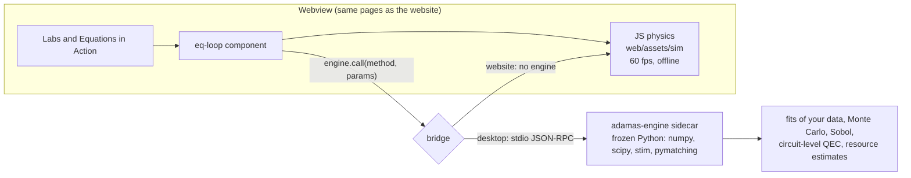
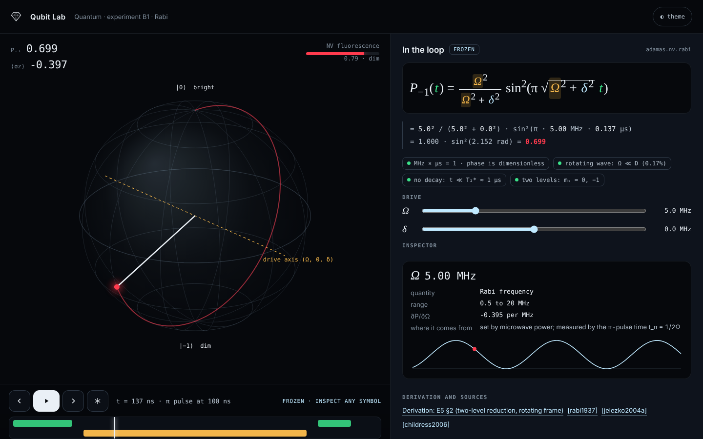

# Desktop app architecture: proposal (Phase 0 draft)

Status: **proposal for review at the Phase 0 gate.** Nothing is wired in yet.

## Where things stand

- **The website** (`web/`, built by `adamas.site`) has 13 labs and the v0.26 Equations in Action page. Every browser
  model is pure JavaScript, and the node tests check it against golden values from the Python package.
- **Branch `claude/v0.26.0`** (pushed, **not merged or released**) already contains a working **Electron** shell
  (`desktop/`). It serves the offline site over an `app://` scheme under a strict Content-Security-Policy. Its
  `--check` mode opens all 32 pages headless with no script errors, and a linux-x64 AppImage was built and checked.
  Release builds for Windows, macOS and Linux come from `.github/workflows/desktop.yml`.
- **The project context asks for Tauri** with the `adamas` Python package as the local engine. That is a different
  shell from the one already built, so the choice is open question 1.

## Shell: Tauri versus the existing Electron build

| | Tauri v2 (asked for) | Electron (built in v0.26) |
|---|---|---|
| Installer size | Small: the shell uses the system webview (*to measure; typically a few MB before the Python engine*) | About 115 MB (deb) to 145 MB (AppImage), measured here |
| Rendering engine | System webview: WebView2 (Chromium) on Windows, WKWebView on macOS, WebKitGTK on Linux. WebGL and three.js behave a little differently on each | The same Chromium everywhere, so what CI tests is what users get |
| 60 fps 3-D labs | Good on Windows and macOS. WebKitGTK on Linux is the weak spot | Predictable |
| Security model | Capabilities and permissions per command; Rust core | Sandbox, context isolation and CSP (in place) |
| Python engine | Built-in **sidecar** support (`externalBin` plus `@tauri-apps/plugin-shell` `Command.sidecar`, with `shell:allow-spawn` granted in a capability) | Spawned with `child_process`; works but is hand-rolled |
| Toolchain | Rust in CI and for local builds | Node only (done) |
| Work left | New shell, CI and signing; reuse `site --offline` and `icons` | Fix 15 review findings, then release |

**Recommendation:** go with **Tauri** as the context asks. Its sidecar model fits "Python as the engine" and the
installer is smaller. Keep the Electron build as the fallback until Tauri passes the same per-page self-test on all
three systems, with WebKitGTK on Linux as the acceptance test. If you would rather ship sooner, release Electron as
v0.26 and port to Tauri in roadmap step 5. Either way, the web code stays identical.

## Engine: how Python is used



- **Two speeds.** Anything drawn every frame stays in the tested JavaScript twin, since a round trip per frame would
  break 60 fps. Heavy or authoritative jobs (fitting your measured data, uncertainty and Sobol, Stim and PyMatching
  QEC, resource estimates) go to Python. Results arrive asynchronously, with progress shown.
- **Transport: JSON-RPC over stdin and stdout, not a network port.** Nothing listens on localhost and there is no
  firewall prompt. Each request carries an id and the engine replies on one line. The sidecar is `python -m adamas
  engine` frozen with PyInstaller into one binary per target, named with Tauri's target-triple suffix.
- **One source of truth.** Scene metadata (equations, symbols, units, assumptions, validity checks, sources) moves
  from `adamas/action.py` into a general `adamas.loop` registry that all labs use. The golden-value tests extend to
  every lab model.
- **The website keeps working.** Without the engine, heavy actions either run the JavaScript approximation, labeled
  as such, or are disabled with a "desktop app" note. A later option is Pyodide (Python compiled to WebAssembly),
  but Stim is not available for it.
- **Size budget.** The frozen engine will dominate the installer (numpy, scipy, stim). *Measure before committing;
  scipy is the largest dependency and could be dropped from the engine if fits move to numpy-only routines.*

## Equation-in-the-loop component

Mockup on the Qubit Lab: `docs/phase0/mockup/qubit_equation_panel.html`, screenshots `qubit_equation_panel_dark.png`
and `qubit_equation_panel_light.png`. It is interactive: open it in a browser, drag Ω or δ, press Space, ← →, or F.



What it adds over v0.26's Equations in Action:

| Feature | In the mockup | Spec |
|---|---|---|
| Live substitution | yes | Every symbol replaced by its value with units, in two lines (substitution, then result) |
| Units check | yes | Chips confirm dimensions (here MHz × µs = 1). In the engine, units come from a typed table and are asserted in tests |
| Assumptions and validity | yes | Each assumption is a chip that turns amber when the state violates it (rotating wave: Ω ≪ D; no decay: t ≪ T₂*) |
| Time control | yes | Play, pause, step ±5 ns, freeze, and scrub on the pulse-sequence timeline |
| Inspector | yes | Click any symbol: value, unit, range, where it comes from, local sensitivity ∂P/∂x, and P plotted against that variable |
| Derivation and sources | yes | Links to the chapter section and reference keys |
| Practice mode (virtual bench) | no (next) | The same panel with "fit my data": drop a CSV and the engine fits it, then overlays the result |

**Design notes.** The type pairs IBM Plex Sans for the interface, IBM Plex Mono with tabular figures for numbers, and
STIX Two for the math. Accents follow the physics: NV fluorescence red, pump green, microwave amber, and a cool
"ice" highlight for refractive diamond. The faceted sphere is the first step toward the crystalline identity. The
mockup has dark and light themes and keyboard control. Reduced motion stops the slow rotation. Not done yet: a WCAG
contrast pass on the amber-on-light chips, and the Impeccable audit, since that skill is not installed in this
session.

## Build and release (Tauri path, proposed)

1. `src-tauri/` holds the Tauri config. `frontendDist` points at the `adamas.site --offline` output, already built.
2. `adamas engine` gets a stdio JSON-RPC loop with methods `fit`, `uncertainty`, `sobol`, `qec`, `estimate`, `version`.
3. CI: PyInstaller builds the engine on each OS, `tauri build` bundles it as a sidecar, and the same `--check`-style
   page self-test runs. Installers are attached to the release as in v0.26.

## Ubuntu commands to try the mockup and v0.26 locally

```bash
cd ~/projects/adamas-diamond-framework
git fetch origin claude/phase0-audit && git switch claude/phase0-audit
python -m http.server -d docs/phase0/mockup 8090      # open http://localhost:8090/qubit_equation_panel.html in Windows
```
