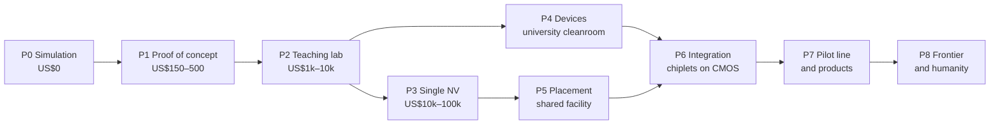

# Build program P0–P8 and the Machines and Facilities Atlas: outline (Phase 0 draft)

Status: **outline for review at the Phase 0 gate.** P0 and P1 are now written in full in [docs/build](../build/README.md) (v0.29.0), where the P1 budget is computed from the part lists instead of the draft range below. Nothing else here is final. Full phase write-ups are roadmap
steps 1 and 3, and full Atlas entries are step 2. Budgets come from `adamas/experiments.py`, which already prices
experiments A1–D2. Any number marked *to source* still needs a citation before it ships, per the rigor rules.

Every phase gets the same template in its full version: goal · physics and equations (with assumptions and
validity) · machines and consumables (Atlas IDs, new and used prices) · facility (power, gases, cooling, cleanroom
class, safety, permits) · procedure · expected results (simulated in the app) · pass/fail metrics · failure modes ·
references · decision gate.

## The ladder at a glance

P4 (classical devices) and P3 to P5 (quantum) are parallel tracks. They meet at P6.

## Phases

| Phase | Goal | Core physics and equations | Existing repo assets | Atlas tools (IDs below) | Facility | Headline pass/fail metric | Gate question |
|---|---|---|---|---|---|---|---|
| **P0 Simulation** | Every later step is runnable in the app and calibrated against published data | All 14 equations-in-action scenes; Lindblad and echo gate budget; circuit-level QEC (Stim); yield; Baliga limit | `adamas` package, 14 scenes, validation matrix (18/19), Data Lab | M00 | Laptop | Every model reproduces its calibration point within its stated tolerance (VALIDATION.md) | Do the models agree with published data well enough to plan hardware? |
| **P1 Proof of concept** | Ensemble ODMR magnetometer (A1 kit): measure a field, and the shift of the zero-field splitting with temperature | Spin Hamiltonian, f± = D ± γB∥, dD/dT = −74.2 kHz/K [acosta2010], dipole field 1/r³ (A2) | A1 kit firmware (`hardware/a1_odmr`), A2, A3 | M30 M31 M32 M33 M34 M35 M36 M37 | Desk; laser eye safety if a laser module is used | Dip found near 2870 MHz; splitting tracks 2γB; D shift matches −74 kHz/K within error (*tolerance to source*) | Is the signal-to-noise good enough to move to pulsed control? |
| **P2 Teaching lab** | Pulsed control (Rabi, Ramsey, Hahn echo), T1 and T2, vector magnetometry, Arrhenius fit for boron activation | Rabi formula, Ramsey envelope, echo e^(−(τ/T₂)^p), Σ(B·n̂ᵢ)² = (4/3)\|B\|², neutrality equation for p(T) | B1, B2, B3 experiments; Qubit Lab; Data Lab fits | M38 M39 M40 M41 M42 M43 M44 M45 M46 | Teaching lab; Class 3B laser controls; hot stage | π pulse identified; T₂* and T₂ fitted with uncertainties; E_A within the B3 window (corrected Arrhenius fit) | Can we hold a spin coherent and measure deep dopants reliably? |
| **P3 Single NV** | Confocal microscope, g²(0) antibunching, single-spin coherent control, nuclear-spin register | g²(τ) = 1 − ρ²e^(−\|τ\|/τ₁), hyperfine (2.16 MHz ¹⁴N), electron–nuclear gates, repetitive readout | C1 experiment; Photon Lab; `adamas.register` | M47 M48 M49 M50 M51 M52 M53 M54 | Research lab, optical table, Class 3B/4 laser | g²(0) < 0.5; hyperfine-resolved ODMR; nuclear-spin Rabi | Do we have single, addressable registers? |
| **P4 Devices** | Hydrogen-terminated, surface-transfer-doped FETs with Al₂O₃; I–V, breakdown and temperature tests; photoelectric NV readout | Square-law and velocity-saturated FET, surface transfer doping, breakdown and leakage versus dislocation density (new, from the audit), photocurrent readout budget | Traveler T1 (20 steps), C2, PDK-0, Transistor Lab | M10 M11 M12 M13 M14 M15 M16 M17 M18 M19 M55 | University cleanroom (class *to source*); acids (HF, perchloric), toxic and flammable gases, high voltage | Working FETs on a hot chuck; contact resistance, mobility and threshold extracted; breakdown measured | Do our devices match the models, and is the process stable from run to run? |
| **P5 Placement** | Implant through masks, anneal, conversion-yield statistics, NV pairs < 30 nm, room-temperature two-NV entanglement | Implantation range and straggle, N→NV conversion yield, pair yield ∝ (yield)², dipolar coupling 52 MHz·nm³/r³, gate budget F(q, T₂); **addressing at sub-diffraction spacing** (audit issue 3) | D1 experiment, `adamas.coupling`, `gate_budget` | M20 M21 M22 M23 M24 M25 M47–M54 | Shared facility: implanter, high-vacuum anneal, ion-beam safety | Conversion yield measured; coupled pairs found; Bell fidelity above 0.5 with charge-state preparation reported | Is placement yield good enough to plan arrays? |
| **P6 Integration** | Diamond chiplets bonded to silicon CMOS control; multi-cell arrays; a logical-qubit attempt | Bond thermal and electrical budgets, readout chain noise, small-code QEC (repetition, then surface code), readout-time design rule | E2, E6, E10, `circuit_qec`, The Chip Stack lab | M26 M27 M28 M29 + all earlier | Advanced packaging line or multi-project wafer (MPW) partner | Chiplet works after bonding; repetition-code gain over a single qubit (*criterion to define*) | Does integration keep coherence and yield? |
| **P7 Pilot line and products** | Wafer-scale flow, statistical process control (SPC), yield models; product lines (power switches, RF amplifiers, harsh-environment logic, quantum sensors, qubit chips) | Poisson and Murphy yield, cost per good die, defect density effects on leakage and coherence | D2, APPLICATIONS.md, Wafer Lab | M01–M09 plus all fab and metrology | Fab with full environmental health and safety (EHS) program | Defect density and yield on control charts; first product qualified (*criteria per product*) | Which product line pays for the line? |
| **P8 Frontier and humanity** | Grid and EV efficiency, space and nuclear electronics, NV medical magnetometry, GPS-free navigation, room-temperature quantum simulation | Converter loss models, radiation hardness, magnetometer sensitivity and shielding, magnetic-anomaly navigation | E9, E11 application atlas, Power Lab | M56 M57 M58 M59 | Application-specific (test benches, shielded rooms, irradiation facilities) | Honest technology readiness level (TRL) per application with its key unsolved problem | Where does diamond beat the incumbent, with evidence? |

## Machines and Facilities Atlas: tool list per phase

Full entries (physics, 3-D model, specs, vendors without endorsement, new and used prices, facility needs and safety,
where the traveler uses it, silicon equivalent) come in roadmap step 2. Here is the list only.

| ID | Tool class | Used in | Silicon equivalent |
|---|---|---|---|
| M00 | Workstation plus open tools (adamas, Stim, PyMatching, ngspice, Yosys, KLayout, OpenROAD) | P0 | Same, plus commercial EDA |
| **Crystal and wafer** | | | |
| M01 | Microwave plasma chemical vapor deposition (MPCVD) reactor | P4 (H-termination), P7 (growth) | Epitaxy reactor |
| M02 | High-pressure high-temperature (HPHT) press, or purchased HPHT seeds | P7 | Czochralski puller |
| M03 | Heteroepitaxy stack deposition (iridium on YSZ/Si or sapphire, bias-enhanced nucleation) | P7 | (none; silicon is homoepitaxial) |
| M04 | Laser cutting and slicing | P7 | Wire saw |
| M05 | Lapping, polishing, scaife or chemo-mechanical polishing | P7 | Chemical-mechanical polishing (CMP) |
| M06 | Raman mapping | P4, P7 | Raman and stress metrology |
| M07 | X-ray diffraction (XRD) rocking curves and topography | P7 | XRD |
| M08 | Photoluminescence (PL) and NV-density mapping | P5, P7 | PL mapping |
| M09 | Defect inspection (birefringence, etch-pit counting) | P7 | Wafer inspection |
| **Device fab** | | | |
| M10 | Wet bench: tri-acid and piranha cleans, HF | P4, P5 | Same |
| M11 | Optical lithography (mask aligner or laser writer) | P4 | Stepper or scanner (EUV for context, E1) |
| M12 | Electron-beam lithography | P4, P5 | E-beam for masks and research |
| M13 | Electron-beam evaporator (Ti/Pt/Au, Au) | P4 | Physical vapor deposition (PVD) cluster |
| M14 | Atomic layer deposition (ALD) of Al₂O₃ | P4 | ALD for high-k gates |
| M15 | Oxygen plasma asher or reactive-ion etch for isolation | P4 | Same |
| M16 | Inductively coupled plasma reactive-ion etching (ICP-RIE) | P4, P7 | ICP etch |
| M17 | Probe station, hot chuck, semiconductor parameter analyzer | P4 | Parametric test |
| M18 | High-voltage curve tracer for breakdown | P4, P7 | Same |
| M19 | Profilometer, optical microscope, four-point probe | P2, P4 | Same |
| **Placement** | | | |
| M20 | Low-energy ion implanter (¹⁵N) | P5 | Ion implanter |
| M21 | Aperture masks (PMMA, AFM-tip) or focused ion beam | P5 | (no equivalent) |
| M22 | High-vacuum annealing furnace (800–1200 °C) | P5 | Rapid thermal anneal |
| M23 | Secondary-ion mass spectrometry (SIMS) | P5, P7 | SIMS |
| M24 | Atomic force microscopy (AFM) | P4, P5 | AFM |
| M25 | Laser writing of vacancies (detect-and-repair) | P5 | (no equivalent) |
| **Integration** | | | |
| M26 | Wafer or die bonder (thermocompression, hybrid) | P6 | Advanced packaging |
| M27 | Dicing (laser or saw) | P6, P7 | Dicing |
| M28 | Wire bonder and package | P6 | Same |
| M29 | CMOS control chip from a multi-project wafer (MPW) shuttle | P6 | The control die itself |
| **Quantum control and optics** | | | |
| M30 | Green source: LED or under 1 mW 532 nm laser module | P1 | — |
| M31 | NV-rich diamond (irradiated and annealed HPHT) | P1 | — |
| M32 | Longpass filter | P1 | — |
| M33 | Silicon photodiode and transimpedance amplifier | P1 | — |
| M34 | Phase-locked loop (PLL) microwave synthesizer, ADF4351 class | P1 | — |
| M35 | Microstrip or loop antenna | P1 | — |
| M36 | Microcontroller (Raspberry Pi Pico) | P1 | — |
| M37 | Permanent magnets and a non-magnetic rail; thermistor and heater for dD/dT | P1 | — |
| M38 | 532 nm laser, tens of mW | P2 | — |
| M39 | Acousto-optic modulator (AOM) | P2 | — |
| M40 | Amplified photodiode or avalanche photodiode | P2 | — |
| M41 | Fast RF switch and 1–10 W microwave amplifier | P2 | — |
| M42 | Pulse timing: FPGA board or pulse generator | P2 | — |
| M43 | Helmholtz coil set and current supplies | P2 | — |
| M44 | Hot stage (to about 500 °C) | P2 | — |
| M45 | Source-measure unit (SMU) | P2 | — |
| M46 | Optical breadboard, mounts, laser goggles and interlock | P2 | — |
| M47 | High numerical-aperture objective | P3, P5 | — |
| M48 | Galvo or piezo scanning | P3 | — |
| M49 | Two single-photon avalanche diodes (SPADs) | P3 | — |
| M50 | Time tagger (picosecond correlator) | P3 | — |
| M51 | Arbitrary waveform generator (AWG) | P3, P5 | — |
| M52 | Electronic-grade, low-nitrogen, optionally ¹²C-enriched CVD diamond | P3, P5 | — |
| M53 | RF source for nuclear spins (MHz range) | P3 | — |
| M54 | Two-color excitation for charge-state readout (orange or red laser) | P3, P5 | — |
| M55 | Photoelectric readout chain (bias electrodes, lock-in, transimpedance) | P4, P6 | — |
| **Applications** | | | |
| M56 | Converter test bench (double-pulse tester, power analyzer, thermal camera) | P8 | Same |
| M57 | Irradiation access (gamma, proton) | P8 | Same |
| M58 | Magnetically shielded room or gradiometer setup | P8 | — |
| M59 | Navigation test platform with a magnetic-anomaly map | P8 | — |

## What exists versus what is new

- **Exists:** experiments A1–D2 cover P1–P5 in part, the traveler covers P4, and APPLICATIONS.md covers P7. The
  Equations in Action page (v0.26) is a first version of the equation-in-the-loop idea.
- **New:** P0 calibration reports, P6 integration (bonding, CMOS control), every pass/fail criterion with a source,
  facility requirements (cleanroom class, gases, permits), used-equipment prices, the defect-density models (audit
  issue 2), the addressing chapter (audit issue 3), and the Atlas with 3-D models.
