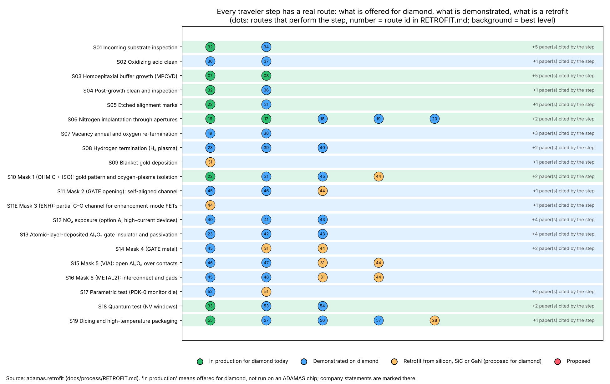

# Retrofit Map: real processes for every build stage

*Generated by `adamas build docs` from `adamas/retrofit.py`; do not edit by hand.*

This page answers one question for each stage of the build: **what real process, tool, service or product exists today that a group can use, or retrofit from silicon, silicon carbide (SiC) or gallium nitride (GaN) manufacturing?** Each route gives the numbers its source states and what is still left to do. Maturity levels:

- **in production**: In production for diamond today.
- **on diamond**: Demonstrated on diamond.
- **retrofit**: Retrofit from silicon, SiC or GaN (proposed for diamond).
- **proposed**: Proposed.

A retrofit route is a proposal of this repository until someone runs it on diamond. Products show that a device type is real; they do not make the ADAMAS processor real, and none is compared with superconducting or other qubits.

Of 57 routes: 15 in production, 37 demonstrated on diamond, 5 retrofit, 0 proposed. 9 products or deployments cover 3 device types sold today as devices (QDL-01, QDL-17, QDL-19) and 2 whose NV diamond material is sold (QDL-12, QDL-20). Every one of the 20 traveler steps now has at least one route that performs it (20 of 20): 8 have a route in production for diamond (S01, S03, S04, S05, S06, S10, S18, S19), 12 have a diamond demonstration, and 0 rest only on a retrofit or proposal. A route counts for a step only if it performs that step (the 'Routes' column below); a step is also 'on diamond' when its own parameters cite a diamond paper. 'In production' means the process or tool is offered for diamond, not that it has been run on an ADAMAS chip.

## W1 · Wafers (best: in production)

| Route | Process | Who | Maturity | What the source states | What is left |
|---|---|---|---|---|---|
| R01 | Electronic-grade CVD single-crystal plates | Element Six online store | **in production** | 2.0 × 2.0 × 0.5 mm and 4.0 × 4.0 × 0.5 mm electronic-grade plates sold with list prices [e6cvd2026] | Plates, not wafers: every cleanroom step runs on small pieces until wafers are used |
| R02 | Heteroepitaxial wafers on iridium/sapphire (KENZAN Diamond) | Orbray | **in production** | 'Two-inch diamond substrate is available', with four-inch as the next stage (company statement); peer-reviewed two-inch (001) growth on misoriented sapphire by step flow [orbray2026] [kim2021] | NV coherence on these wafers is to be measured |
| R03 | Three-inch wafer process and volume two-inch supply | Element Six with Orbray | **on diamond** | Industry announcement of a reproducible three-inch process, with two-inch prepared for volume production (company statement) [e6orbray2026] | No paper yet; wafer specifications to be published |
| R04 | Heteroepitaxy on iridium/yttria-stabilized zirconia (YSZ)/silicon with bias-enhanced nucleation | University of Augsburg | **on diamond** | One single crystal about 90 mm across and 155 carats, 1.6 ± 0.25 mm thick; dislocation density about 4 × 10⁷ cm⁻² after 1.5 mm of growth [schreck2017] | Electronic-grade purity and NV coherence on such wafers are to be shown |
| R05 | Mosaic wafer tiled from lift-off plates | AIST (National Institute of Advanced Industrial Science and Technology, Japan) | **on diamond** | Two-inch mosaic (40 × 60 mm²) made from 24 plates of 10 × 10 mm² [yamada2014] | Proposed: place dies away from the tile boundaries |
| R06 | 100 mm and 200 mm single-crystal diamond | Diamond Foundry | **on diamond** | 'a single crystal of diamond 100mm in diameter' weighing 110 carats (2023); a 200 mm single crystal shown in November 2026 (company statements, no paper or process) [diamondfoundry2023] [diamondfoundry2026] | No published growth process, purity or defect data |

## W2 · Growth reactors (best: in production)

Traveler steps: S03 ([TRAVELER.md](TRAVELER.md)).

| Route | Process | Who | Maturity | What the source states | What is left |
|---|---|---|---|---|---|
| R07 | Microwave plasma chemical vapor deposition (MPCVD) reactor for single-crystal growth (SDS6K) | Seki Diamond Systems, sold by Cornes Technologies | **in production** | 6 kW at 2.45 GHz, standard 50 mm (2-inch) holder, 10 to 220 Torr [cornes2025] | Buy or use one; the traveler's S03 recipe sets the gas and temperature |
| R08 | 915 MHz and 2.45 GHz microwave generators for single-crystal diamond | MKS Instruments | **in production** | Generators for electronic-grade single-crystal growth at pressures above 160 Torr (company statement) [mks2026] | Generators only; the reactor body comes from another maker or a laboratory design |
| R09 | High-rate single-crystal growth and the direct-wafer process | AIST | **on diamond** | 2.45 GHz, 5 kW reactor; CH₄/H₂ at 60 and 500 sccm, 21 kPa, about 1100 to 1200 °C; seed ion-implanted to make a graphitizing layer so the grown plate lifts off [chayahara2011] | The quantum layer is grown separately with the S03 recipe |

## W3 · Slicing and lift-off (best: on diamond)

| Route | Process | Who | Maturity | What the source states | What is left |
|---|---|---|---|---|---|
| R10 | Lift-off by MeV ion implantation | Research (Parikh and co-workers) | **on diamond** | 4 to 5 MeV carbon or oxygen ions make a buried damaged layer (oxygen at 3 × 10¹⁷ cm⁻² or more); after annealing it is etched in acid or in oxygen at 550 to 600 °C, releasing the plate [parikh1992] | Needs a MeV implanter (HZDR offers up to 6 MV, route R17) |
| R11 | Laser slicing at the {100} plane | Chiba University with Orbray | **on diamond** | An irradiation sequence that stops cracks running along {111} planes slices diamond at {100} [sakamoto2023] | Kerf and thickness not given in the parts read |
| R12 | KABRA laser slicing (silicon carbide) | DISCO | **retrofit** | Slices ingots larger than 50 mm into wafers 100 µm thick or less (silicon carbide) [disco2024] | Not shown on diamond; proposed here as the volume route once diamond boules exist |

## W4 · Polishing (best: in production)

Traveler steps: S01, S04 ([TRAVELER.md](TRAVELER.md)).

| Route | Process | Who | Maturity | What the source states | What is left |
|---|---|---|---|---|---|
| R13 | Plasma-assisted polishing | Research (Liu, Yamamura and co-workers) | **on diamond** | Sq 0.361 nm over 5 µm on a 21 × 19 mm mosaic, removal 13.3 µm/h, argon-oxygen plasma at 13.56 MHz and 100 W, 0.8 kPa, reported damage-free [liu2020] | A research tool; no commercial version was found |
| R14 | Chemical-mechanical polishing (CMP) | Cardiff University; Fraunhofer USA CMW as a service | **on diamond** | Nanocrystalline diamond film from 18.3 to 1.7 nm root-mean-square (rms) roughness in 4 h with colloidal silica (0.42 nm rms locally); the Fraunhofer USA service states sub-nanometer roughness over large-area diamond wafers (company statement) [thomas2014] [fraunhofercmw2026] | The paper used polycrystalline film; the service does not state the crystal type |
| R15 | Grinding, polishing, laser cutting, plasma etching and metallization as a service | Diamond Materials GmbH | **in production** | Lists these services for customer diamond (company statement, no specifications) [diamondmaterials2026] | Ask for roughness and thickness tolerances |

## Q1 · Cleaning and inspection (best: in production)

Traveler steps: S01, S02, S04 ([TRAVELER.md](TRAVELER.md)).

| Route | Process | Who | Maturity | What the source states | What is left |
|---|---|---|---|---|---|
| R32 | Confocal Raman and photoluminescence mapping (inVia) | Renishaw | **in production** | Company page: determines 'diamond stress, purity and origin' and maps the 1332 cm⁻¹ Raman line and the 1.95 eV NV⁻ photoluminescence band of a hot-filament chemical vapor deposition (CVD) diamond film (company statement) [renishaw2026] | Use for incoming and post-growth inspection; set pass limits from the S01 checks |
| R34 | Birefringence imaging and X-ray topography of defects | Research (Moore and co-workers) | **on diamond** | Rotating-analyser polarizing microscope at 589 nm: birefringence Δn up to 15 × 10⁻³ at growth-sector boundaries and about 1.8 × 10⁻³ in low-strain regions; X-ray rocking curves about 20 arcsec (high-pressure high-temperature (HPHT) synthetic diamond) [moore2016] | Shown on HPHT diamond; a commercial topography service for diamond was not found |
| R35 | Quantum-grade single-crystal plates with a published acceptance sheet | Coherent | **in production** | Datasheet values: substitutional nitrogen 800 ppb, NV 300 ppb, areal average surface roughness (Sa) below 0.5 nm, T2 200 µs, T2* 1 µs (company statement) [coherentqg2026] | An acceptance sheet, not an inspection: compare it with the S01 pass windows before buying; no birefringence value is stated |
| R36 | Tri-acid clean | Research (Sangtawesin and co-workers) | **on diamond** | Refluxing 1:1:1 sulfuric, nitric and perchloric acid for at least one hour, before etching and before every anneal; a 1:2 hydrogen peroxide in sulfuric acid piranha after the oxygen anneal [sangtawesin2019] | Perchloric acid needs a rated fume hood and institutional training |
| R37 | Nitrate-sulfuric acid clean followed by hot piranha | Research (McCloskey and co-workers) | **on diamond** | 1:20 w/w sodium nitrate in sulfuric acid for 30 min, then 1:4 v/v hydrogen peroxide in sulfuric acid for 10 min, on an NV sample [mccloskey2024] | Avoids perchloric acid; published in Advanced Materials Interfaces (2024); the numbers were read from the preprint |

## P1 · Etching and marks (best: in production)

Traveler steps: S05, S10 ([TRAVELER.md](TRAVELER.md)).

| Route | Process | Who | Maturity | What the source states | What is left |
|---|---|---|---|---|---|
| R21 | Deep inductively coupled plasma etch with near-zero micromasking | University College London | **on diamond** | 45.1 nm/min in argon-oxygen (20 % O₂, 200 W) with a 20 s argon-chlorine clean every 2 min; 16.9 : 1 selectivity to an aluminium mask; 0.47 nm surface roughness; deeper than 10 µm [hicks2019] | Use for marks (S05) and isolation (S10) |
| R22 | Plasma etch tools for quantum diamond | Oxford Instruments (PlasmaPro 100 Cobra inductively coupled plasma (ICP) and reactive ion etching (RIE)) | **in production** | Surface roughness Ra below 0.3 nm on diamond for NV work (company statement) [oxinst2026] | Tool for sale; the same class is on shared cleanroom rate sheets (Atlas M16) |

## P2 · Nitrogen and NV creation (best: in production)

Traveler steps: S06, S07 ([TRAVELER.md](TRAVELER.md)).

| Route | Process | Who | Maturity | What the source states | What is left |
|---|---|---|---|---|---|
| R16 | Ion implantation service that lists diamond | Ion Beam Services (IBS), France | **in production** | Lists diamond among implanted substrates; samples up to 12-inch wafers; for SiC, 5 to 400 keV with nitrogen among the species [ibs2026] | Diamond is listed only as a substrate, with no energy range or species for it; the page offers plasma immersion from 50 V to 20 kV and molecular ions including N₂; ask for ¹⁵N at the S06 energy and dose |
| R17 | Ion implantation from 10 kV to 6 MV | HZDR Innovation (Helmholtz-Zentrum Dresden-Rossendorf), Germany | **in production** | Species from hydrogen to gold, small samples up to 200 mm wafers [hzdr2026] | Also the MeV source for lift-off (R10) |
| R18 | Nitrogen delta-doping during growth | Research (Awschalom group) | **on diamond** | Nitrogen layers at depths of 5 to 100 nm; T₂ above 100 µs at 5 nm and above 600 µs at 50 nm or deeper [ohno2012] | An alternative to S06: no implant damage, but no lateral placement |
| R19 | Laser writing of single NV centers | Research (Oxford and Warwick) | **on diamond** | Single NV centers with up to 45 % success per site, within about 200 nm of the target; anneal 3 h at 1000 °C [chen2017] | The detect-and-repair route of build phase P5 (Atlas M25) |
| R20 | NV arrays through masks | Research (Awschalom and Schenkel groups) | **on diamond** | Nanofabrication of single NV centers on sub-100 nm length scales across a chip [toyli2010] | Yield is statistical (Poisson); see build phase P5 |
| R38 | Staged vacuum anneal to 1200 °C and oxygen re-termination | Research (Sangtawesin and co-workers) | **on diamond** | Vacuum 1 × 10⁻⁷ to 2 × 10⁻⁶ Torr; holds of 11 h at 100 °C, 8 h at 400 °C and 8 h at 800 °C, ramp to 1200 °C over 6 to 12 h and hold 2 h; then oxygen at 445 to 450 °C and atmospheric pressure for 4 h (diamond etches in oxygen from about 500 °C) [sangtawesin2019] | An earlier study also reported longer T2 after 1200 °C [naydenov2010]; a furnace sold for this use was not found |

## P3 · Surface, gate oxide and transistors (best: on diamond)

Traveler steps: S08, S11, S11E, S12, S13 ([TRAVELER.md](TRAVELER.md)).

| Route | Process | Who | Maturity | What the source states | What is left |
|---|---|---|---|---|---|
| R23 | Hydrogen-terminated field-effect transistors (FETs) with atomic-layer-deposited Al₂O₃ | Waseda University (Kawarada group) | **on diamond** | Al₂O₃ deposited at 450 °C, 200 nm gate insulator; breakdown 1700 V at room temperature and 1200 V at 300 and 400 °C; drain current within 30 % from room temperature to 400 °C [kawarada2017] [kawarada2014] | No foundry offering was found |
| R39 | Hydrogen termination that preserves NV centers | Research (McCloskey and co-workers) | **on diamond** | Heated hydrogen plasma (10 Torr, 500 standard cubic centimetres per minute (sccm) H₂, 400 W, 10 min, stage 800 °C) lost almost 50 % of NV photoluminescence; an unheated plasma (at most 120 °C) showed no clear loss; a forming-gas alternative ran at 950 °C for 1 h (7 sccm H₂ in 150 sccm N₂) [mccloskey2024] | Choose the cold plasma for chips that already carry NV centers (S08 comes after S07) |
| R40 | Hydrogen plasma and NO₂ activation | Research (Wade, Geis and co-workers) | **on diamond** | Plasma ramped to 65 Torr and 5 kW, held 30 min; 1 min in NO₂ gave 1 to 2 kΩ/sq, against 2.5 to 10 kΩ/sq for other activation, and the resistance rose above 3 kΩ/sq within hours in laboratory air [wade2017] | Cap with Al₂O₃ soon after NO₂ (S13) |
| R41 | NO₂ hole doping of transistors | Research (NTT, Kubovic and Kasu) | **on diamond** | 300 ppm NO₂: hole density up to 2.3 × 10¹⁴ cm⁻² and drain current 1.8 times that in air [kubovic2009] [nttbrl2009] | Exposure time is not stated in the summary read |
| R42 | Plasma-enhanced ALD Al₂O₃ with hydrogen-plasma recovery | Research (Yang and co-workers) | **on diamond** | Al₂O₃ from dimethylaluminium isopropoxide and oxygen plasma at 100 °C, about 1.5 Å per cycle; the first ~1 nm raised the resistance from ~30 kΩ to ~3 MΩ, and a hydrogen plasma at 500 °C for 30 min brought it back to ~20 kΩ [yang2017] | Thermal ALD (trimethylaluminium and water) is the traveler's choice; this is the alternative |
| R43 | ALD Al₂O₃ passivation after NO₂ | Research (NTT, Kasu and co-workers) | **on diamond** | 10 nm ALD Al₂O₃ after 2 % NO₂ in N₂: drain current −200 mA/mm at room temperature, stable up to 200 °C [kasu2012] [nttbrl2011] | Deposition temperature and cycles are not stated in the summary read |

## P4 · Bonding and integration (best: on diamond)

Traveler steps: S19 ([TRAVELER.md](TRAVELER.md)).

| Route | Process | Who | Maturity | What the source states | What is left |
|---|---|---|---|---|---|
| R24 | Room-temperature Au/Au atomic diffusion bonding to silicon | AIST | **on diamond** | Ti/Au 5/12 nm layers bond single-crystal diamond to silicon in air; the silicon broke before the bond in shear tests [matsumae2018] | The route to put a diamond die on a complementary metal-oxide-semiconductor (CMOS) chip (X27a) |
| R25 | Surface-activated bonding of GaN to diamond | Research (Liang and co-workers) | **on diamond** | Interface stable when heated to 1000 °C [liang2021] | For GaN-on-diamond power and radio-frequency devices |
| R26 | Quantum microchiplets on a photonic chip | Research (Wan and co-workers) | **on diamond** | A 128-channel defect-free array of germanium- and silicon-vacancy diamond microchiplets on an aluminium nitride photonic circuit (color centers other than NV), measured in a closed-cycle cryostat below 4 K (cryogenic; wording of the preprint) [wan2020] [wan2019] | Proposed here for NV chiplets; not shown with NV or at room temperature |

## P5 · Packaging and heat (best: in production)

Traveler steps: S19 ([TRAVELER.md](TRAVELER.md)).

| Route | Process | Who | Maturity | What the source states | What is left |
|---|---|---|---|---|---|
| R27 | High-temperature reliability of diamond power devices | AIST | **on diamond** | No change over 1500 hours at 400 °C; operation at 250 °C in a 1 A class device [shikata2013] | The package itself is listed as a research item there |
| R28 | Pressureless silver sintering (power-module die attach) | Research on a non-diamond Schottky diode | **retrofit** | Sintered at 290 °C for 40 min without pressure [dai2023] | Not shown on diamond; proposed for S19 because it stays below the 500 °C hydrogen limit |
| R29 | Diamond heat spreaders | Element Six | **in production** | Thermal conductivity from 1000 to 2200 W/(m·K), for radio-frequency power amplifiers and laser diodes [e6thermal2026] | Passive diamond in production today |
| R30 | GaN-on-diamond amplifiers in orbit | Akash Systems | **in production** | 5 W continuous wave at 8.4 GHz on Pixxel's Firefly satellites; described as the first GaN-on-diamond device in space [akash2026] | Diamond as a heat sink, not as a semiconductor |
| R55 | Laser cutting system for single-crystal diamond (eM15) | Coherent | **in production** | For natural and synthetic single-crystal diamond and CVD wafers; 15 W green (532 nm) laser; 200 × 200 mm travel; 2000 mm/min (company statement; kerf not stated) [coherentem152026] | Measure the kerf and edge damage on a test plate |
| R56 | Water-jet-guided laser cutting of single-crystal diamond | Research (Zhang and co-workers) | **on diamond** | 1 mm thick plate: kerf 74.59 µm with water-jet guidance against 220.8 µm dry; 532 nm, 30 µm nozzle at 400 bar, 11.8 W to cut through [zhang2022] | Narrower kerf than dry cutting |
| R57 | Brazed die attach of diamond | Research (Msolli and co-workers) | **on diamond** | Die brazed with AuGe (melting point 356 °C) or AlSi (577 °C), thermally cycled from −50 to 300 °C [msolli2012] | AuGe brazing needs at least 356 °C, above S19's 350 °C budget: it would need that budget raised and checked against the Al₂O₃ and hydrogen-termination limits; compare with silver sinter at 290 °C (R28) |

## P6 · Lithography and metal (best: in production)

Traveler steps: S09, S10, S11, S11E, S14, S15, S16 ([TRAVELER.md](TRAVELER.md)).

| Route | Process | Who | Maturity | What the source states | What is left |
|---|---|---|---|---|---|
| R31 | Shared university cleanroom: aligners, direct-write lithography, electron-beam evaporation | University cleanrooms (for example the Washington Nanofabrication Facility) | **retrofit** | Hourly rates published for contact aligners, maskless direct writers and electron-beam evaporators (silicon tools) [wnf2026] | The diamond recipes are in the traveler steps; small diamond pieces on silicon-sized tools are this repository's proposal |
| R44 | Tabletop maskless aligner for small pieces (µMLA) | Heidelberg Instruments | **retrofit** | Substrates from 5 mm × 5 mm to 6 inch; minimum feature 0.6, 1 or 3 µm by write mode; 405 and/or 375 nm laser; second-layer alignment 500 nm over 5 × 5 mm² (company statement; general tool, not stated for diamond) [heidelbergumla2026] | Not shown on diamond; the 4 mm plates of R01 (and 3 mm plates of S01) are below the 5 mm × 5 mm minimum, so a carrier would be needed: this repository's proposal |
| R45 | Edge-to-edge resist on small diamond pieces | Research (Strathclyde, Hill and co-workers) | **on diamond** | Spin coating builds resist up at the edges of small samples; printing the resist coats edge to edge; 4 × 4 × 0.5 mm single-crystal plates diced to 2 × 2 mm [hill2016] | Use on the 2 to 4 mm plates of route R01 |
| R46 | Electron-beam lithography and buffered-oxide opening of Al₂O₃ | Research (Qu and co-workers) | **on diamond** | Poly(methyl methacrylate) (PMMA) resist patterned by electron beam; 80 nm Pd contacts; 35 nm evaporated plus 15 nm plasma-ALD Al₂O₃; 10:1 buffered oxide etch removes the Al₂O₃ over the contacts; contact resistance 11.4 Ω·mm [qu2024b] | Published in Advanced Electronic Materials (2025); the numbers were read from the preprint |
| R47 | Pd/Ti/Au contacts and TMAH opening of Al₂O₃ | Research (Liu and co-workers) | **on diamond** | Pd/Ti/Au 10/20/100 nm contacts by electron-beam lithography; Al₂O₃ wet-etched in tetramethylammonium hydroxide (TMAH) for 10 min [liu2016] | An HF-free alternative for the S15 via |
| R48 | Ti/Pt/Au lift-off and Cr/Au pads on an NV device | Research (Broadway and co-workers) | **on diamond** | Ti/Pt/Au 10/10/70 nm evaporated and lifted off, annealed 600 °C for 20 min in 10 Torr H₂; Cr/Au 10/70 nm bond pads [broadway2018] | Shown on a diamond chip with NV sensors |
| R49 | Pt/Au ohmic contacts on hydrogen-terminated diamond | Research (Zhang and co-workers) | **on diamond** | Specific contact resistance 5.65 × 10⁻⁴ Ω·cm² as fabricated (circular transfer-length method) [zhang2019] | Compare with the gold contacts of S09 |
| R50 | Gold metallization of customer diamond | Diamond Materials GmbH | **in production** | 'Gold layers with excellent adhesion and wetting properties', patterning by lithography or shadow masks, AuSn or In solder layers on request, parts down to 0.5 mm (company statement; stack not stated) [diamondmaterialshs2026] | Ask for a gold layer without an adhesion metal for S09, which needs gold on the hydrogen-terminated surface |

## T1 · Electrical and quantum test (best: in production)

Traveler steps: S17, S18 ([TRAVELER.md](TRAVELER.md)).

| Route | Process | Who | Maturity | What the source states | What is left |
|---|---|---|---|---|---|
| R33 | Quality control of NV diamond as a service (quantum diamond scan) | Kwan-tek | **in production** | Measures T1, Hahn-echo T2, T2* and Rabi oscillations and takes spectra of customer NV diamond on an automated bench and returns a report; accepts millimetre-sized NV diamonds doped in volume or in regions, NV nanodiamonds and other color-center diamonds (company statement, no numbers) [kwantek2026] [kwantek2024] | Patterned chips are not mentioned: ask whether they are accepted for the S18 quantum test, and for the measurement conditions |
| R51 | Hot chuck to 400 °C | Micromanipulator | **retrofit** | Wafer testing from −65 to 400 °C for 150 to 300 mm wafers (company statement; general tool, not stated for diamond) [micromanipulator2026] | Not shown on diamond; holding a 4 mm die on a wafer chuck is this repository's proposal |
| R52 | High-temperature test of diamond logic | Research (Liu and co-workers) | **on diamond** | Diamond NOR logic worked at 300 °C and failed at 400 °C (news report of the paper) [liu2018] [aipnews2018] | The S17 hot-chuck limit of 400 °C sits at this failure point |
| R53 | Open-source confocal and ODMR control software (Qudi) | Research (Binder and co-workers) | **on diamond** | Python suite with a confocal scanner and optically detected magnetic resonance (ODMR) logic that sweeps the microwave frequency and records the fluorescence [binder2017] | Free; drives the S18 confocal setup |
| R54 | Room-temperature ODMR on a diamond device | Research (Broadway and co-workers) | **on diamond** | 532 nm, 300 mW continuous at the sample, 40× objective with numerical aperture (NA) 1.3, room temperature [broadway2018] | The optical conditions for the S18 test on a device chip (published in Nature Electronics, 2018; the numbers were read from the preprint) |

## Traveler steps and their best route

| Step | Title | Routes | Diamond papers the step cites | Best level |
|---|---|---|---|---|
| S01 | Incoming substrate inspection | R32, R34 | [friel2009] [schreck2017] [kim2021] [qu2024] [e6orbray2026] | in production |
| S02 | Oxidizing acid clean | R36, R37 | [sangtawesin2019] | on diamond |
| S03 | Homoepitaxial buffer growth (MPCVD) | R07, R08 | [tallaire2013] [lu2013] [bolshakov2020] [teraji2015] [balasubramanian2009] | in production |
| S04 | Post-growth clean and inspection | R32, R36 | [sangtawesin2019] | in production |
| S05 | Etched alignment marks | R21, R22 | [hauf2011] | in production |
| S06 | Nitrogen implantation through apertures | R16, R17, R18, R19, R20 | [pezzagna2010] [ziegler2010] | in production |
| S07 | Vacancy anneal and oxygen re-termination | R19, R38 | [pezzagna2010] [hauf2011] [sangtawesin2019] | on diamond |
| S08 | Hydrogen termination (H₂ plasma) | R23, R39, R40 | [kawarada2023] [stacey2012] | on diamond |
| S09 | Blanket gold deposition | R31 | [kawarada2023] | on diamond |
| S10 | Mask 1 (OHMIC + ISO): gold pattern and oxygen-plasma isolation | R21, R22, R44, R45 | [kawarada2023] [kawarada2014] | in production |
| S11 | Mask 2 (GATE opening): self-aligned channel | R44, R45, R46 | [kawarada2023] | on diamond |
| S11E | Mask 3 (ENH): partial C–O channel for enhancement-mode FETs | R44 | [kitabayashi2017] | on diamond |
| S12 | NO₂ exposure (option A, high-current devices) | R40, R41, R43 | [kasu2012] [hirama2012] [sato2013] [kubovic2009] | on diamond |
| S13 | Atomic-layer-deposited Al₂O₃ gate insulator and passivation | R23, R42, R43 | [kasu2012] [hirama2012] [kawarada2014] [kawarada2017] | on diamond |
| S14 | Mask 4 (GATE metal) | R31, R44, R45 | [kasu2012] [kawarada2023] | on diamond |
| S15 | Mask 5 (VIA): open Al₂O₃ over contacts | R31, R44, R46, R47 | — | on diamond |
| S16 | Mask 6 (METAL2): interconnect and pads | R31, R44, R45, R48 | — | on diamond |
| S17 | Parametric test (PDK-0 monitor die) | R51, R52 | [liu2017] [kawarada2014] | on diamond |
| S18 | Quantum test (NV windows) | R33, R53, R54 | [doherty2013] [aslam2013] | in production |
| S19 | Dicing and high-temperature packaging | R27, R28, R55, R56, R57 | [lutz2018] | in production |

## On the market: NV devices sold or deployed today

| Device | Product | Maturity | What the source states |
|---|---|---|---|
| QDL-17 | Qnami ProteusQ scanning NV microscope | **in production** | Room-temperature operation; sensitivity better than 2 µT/√Hz in continuous-wave operation; samples up to 40 × 50 mm² [qnami2026] |
| QDL-17 | Qnami Quantilever MX diamond tip | **in production** | NV depth down to 10 nm from the apex (simulated by the maker), T₂* above 1 µs typical, tip radius 100 nm [qnami2019] |
| QDL-12 | Element Six DNV-B1 and DNV-B14 quantum-grade diamond (material) | **in production** | DNV-B1: uniform NV concentration with spin lifetimes of a microsecond (2020); DNV-B14: more than ten times the NV density of DNV-B1 (2021) [e6dnv2020] [e6dnv2021] |
| QDL-19 | QuantumDiamonds QD m.0 for chip failure analysis | **in production** | Diamond quantum microscope to find faults in integrated circuits; first production run fully allocated (2024, news report) [quantumdiamonds2024] |
| QDL-01 | Quantum Brilliance room-temperature diamond quantum accelerator | **in production** | Rack-mounted system commissioned at the Pawsey Supercomputing Centre (2022); each processing unit has two qubits and runs at room temperature [qb2022] [ornl2025] |
| QDL-01 | CIQTEK Diamond Quantum Computer for education | **in production** | One-qubit NV teaching instrument that works at room temperature [ciqtek2026] |
| QDL-20 | Adámas Nanotechnologies NV-rich diamond (material) | **in production** | NV-rich plates sold with a list price; the nanodiamonds of the cell-thermometry paper came from the same company [lattispec2026] [kucsko2013] |
| QDL-12 | SBQuantum diamond magnetometer for the MagQuest challenge | **on diamond** | Quantum diamond magnetometer about the size of a quart of milk, for a space launch in the MagQuest challenge (news report, 27 March 2026); a second news report names NV centers in synthetic diamond; no sensitivity stated [sbquantum2026] [qcrsbquantum2026] |
| QDL-12 | Lockheed Martin Dark Ice NV magnetometer | **on diamond** | Prototype magnetometer using NV centers in a synthetic diamond the size of a salt crystal (news report, 2019) [lockheed2019] |

## What a group can do this year

1. Buy electronic-grade plates (R01) or a two-inch heteroepitaxial wafer (R02), and polish by plasma-assisted polishing or a CMP service (R13 to R15).
2. Grow the quantum layer in a commercial 2.45 GHz reactor (R07) with the S03 recipe.
3. Send pieces to an implantation service that lists diamond (R16, R17) for the S06 nitrogen implant, or grow a delta-doped layer instead (R18).
4. Etch and pattern on shared cleanroom tools of the class the Atlas prices (R21, R22; Atlas M11 to M16).
5. Build hydrogen-terminated FETs with ALD Al₂O₃ as published (R23), and bond dies to silicon at room temperature (R24).
6. Clean in tri-acid or a perchloric-free nitrate-sulfuric mix (R36, R37), anneal with the published 1200 °C schedule (R38), and terminate with a cold hydrogen plasma that keeps the NV centers (R39).
7. Inspect by Raman and photoluminescence mapping (R32) against a published acceptance sheet (R35), send NV pieces to a quality-control service (R33), run the confocal test with free software (R53), and dice with a laser sold for single-crystal diamond (R55).
8. Benchmark against products already sold (scanning NV microscopes, quantum-grade diamond, teaching instruments).

Sources: [aipnews2018] [akash2026] [binder2017] [broadway2018] [chayahara2011] [chen2017] [ciqtek2026] [coherentem152026] [coherentqg2026] [cornes2025] [dai2023] [diamondfoundry2023] [diamondfoundry2026] [diamondmaterials2026] [diamondmaterialshs2026] [disco2024] [e6cvd2026] [e6dnv2020] [e6dnv2021] [e6orbray2026] [e6thermal2026] [fraunhofercmw2026] [heidelbergumla2026] [hicks2019] [hill2016] [hzdr2026] [ibs2026] [kasu2012] [kawarada2014] [kawarada2017] [kim2021] [kubovic2009] [kucsko2013] [kwantek2024] [kwantek2026] [lattispec2026] [liang2021] [liu2016] [liu2018] [liu2020] [lockheed2019] [matsumae2018] [mccloskey2024] [micromanipulator2026] [mks2026] [moore2016] [msolli2012] [nttbrl2009] [nttbrl2011] [ohno2012] [orbray2026] [ornl2025] [oxinst2026] [parikh1992] [qb2022] [qcrsbquantum2026] [qnami2019] [qnami2026] [qu2024b] [quantumdiamonds2024] [renishaw2026] [sakamoto2023] [sangtawesin2019] [sbquantum2026] [schreck2017] [shikata2013] [thomas2014] [toyli2010] [wade2017] [wan2019] [wan2020] [wnf2026] [yamada2014] [yang2017] [zhang2019] [zhang2022]
