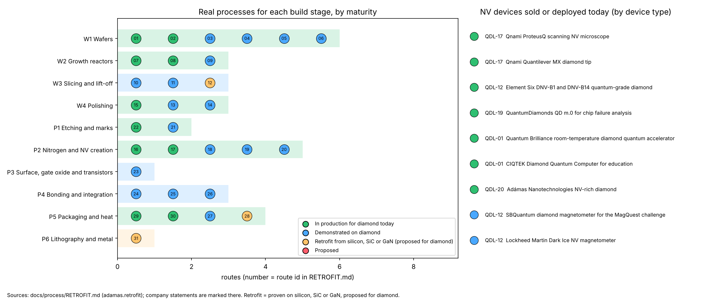

# Retrofit Map: real processes for every build stage

*Generated by `adamas build docs` from `adamas/retrofit.py`; do not edit by hand.*

This page answers one question for each stage of the build: **what real process, tool, service or product exists today that a group can use, or retrofit from silicon, silicon carbide (SiC) or gallium nitride (GaN) manufacturing?** Each route gives the numbers its source states and what is still left to do. Maturity levels:

- **in production**: In production for diamond today.
- **on diamond**: Demonstrated on diamond.
- **retrofit**: Retrofit from silicon, SiC or GaN (proposed for diamond).
- **proposed**: Proposed.

A retrofit route is a proposal of this repository until someone runs it on diamond. Products show that a device type is real; they do not make the ADAMAS processor real, and none is compared with superconducting or other qubits.

Of 31 routes: 10 in production, 18 demonstrated on diamond, 3 retrofit, 0 proposed. 9 products or deployments cover 5 device types sold today (QDL-01, QDL-12, QDL-17, QDL-19, QDL-20). Of the 20 traveler steps, 8 have a route in production and 10 more cite a diamond demonstration; the other 2 (S15, S16) are standard lithography and metal steps on shared cleanroom tools (Atlas M11 to M13).

## W1 · Wafers (best: in production)

| Route | Process | Who | Maturity | What the source states | What is left |
|---|---|---|---|---|---|
| R01 | Electronic-grade CVD single-crystal plates | Element Six online store | **in production** | 2.0 × 2.0 × 0.5 mm and 4.0 × 4.0 × 0.5 mm electronic-grade plates sold with list prices [e6cvd2026] | Plates, not wafers: every cleanroom step runs on small pieces until wafers are used |
| R02 | Heteroepitaxial wafers on iridium/sapphire (KENZAN Diamond) | Orbray | **in production** | 'Two-inch diamond substrate is available', with four-inch as the next stage (company statement); peer-reviewed two-inch (001) growth on misoriented sapphire by step flow [orbray2026] [kim2021] | NV coherence on these wafers is to be measured |
| R03 | Three-inch wafer process and volume two-inch supply | Element Six with Orbray | **on diamond** | Industry announcement of a reproducible three-inch process, with two-inch prepared for volume production (company statement) [e6orbray2026] | No paper yet; wafer specifications to be published |
| R04 | Heteroepitaxy on iridium/YSZ/silicon with bias-enhanced nucleation | University of Augsburg | **on diamond** | One single crystal about 90 mm across and 155 carats, 1.6 ± 0.25 mm thick; dislocation density about 4 × 10⁷ cm⁻² after 1.5 mm of growth [schreck2017] | Electronic-grade purity and NV coherence on such wafers are to be shown |
| R05 | Mosaic wafer tiled from lift-off plates | AIST (National Institute of Advanced Industrial Science and Technology, Japan) | **on diamond** | Two-inch mosaic (40 × 60 mm²) made from 24 plates of 10 × 10 mm² [yamada2014] | Proposed: place dies away from the tile boundaries |
| R06 | 100 mm and 200 mm single-crystal diamond | Diamond Foundry | **on diamond** | 'a single crystal of diamond 100mm in diameter' weighing 110 carats (2023); a 200 mm single crystal shown in November 2026 (company statements, no paper or process) [diamondfoundry2023] [diamondfoundry2026] | No published growth process, purity or defect data |

## W2 · Growth reactors (best: in production)

Traveler steps: S03 ([TRAVELER.md](TRAVELER.md)).

| Route | Process | Who | Maturity | What the source states | What is left |
|---|---|---|---|---|---|
| R07 | MPCVD reactor for single-crystal growth (SDS6K) | Seki Diamond Systems, sold by Cornes Technologies | **in production** | 6 kW at 2.45 GHz, standard 50 mm (2-inch) holder, 10 to 220 Torr [cornes2025] | Buy or use one; the traveler's S03 recipe sets the gas and temperature |
| R08 | 915 MHz and 2.45 GHz microwave generators for single-crystal diamond | MKS Instruments | **in production** | Generators for electronic-grade single-crystal growth at pressures above 160 Torr (company statement) [mks2026] | Generators only; the reactor body comes from another maker or a laboratory design |
| R09 | High-rate single-crystal growth and the direct-wafer process | AIST | **on diamond** | 2.45 GHz, 5 kW reactor; CH₄/H₂ at 60 and 500 sccm, 21 kPa, about 1100 to 1200 °C; seed ion-implanted to make a graphitizing layer so the grown plate lifts off [chayahara2011] | The quantum layer is grown separately with the S03 recipe |

## W3 · Slicing and lift-off (best: on diamond)

| Route | Process | Who | Maturity | What the source states | What is left |
|---|---|---|---|---|---|
| R10 | Lift-off by MeV ion implantation | Research (Parikh and co-workers) | **on diamond** | 4 to 5 MeV carbon or oxygen ions make a buried damaged layer (oxygen at 3 × 10¹⁷ cm⁻² or more); after annealing it is etched in acid or in oxygen at 550 to 600 °C, releasing the plate [parikh1992] | Needs a MeV implanter (HZDR offers up to 6 MV, route R16) |
| R11 | Laser slicing at the {100} plane | Chiba University with Orbray | **on diamond** | An irradiation sequence that stops cracks running along {111} planes slices diamond at {100} [sakamoto2023] | Kerf and thickness not given in the parts read |
| R12 | KABRA laser slicing (silicon carbide) | DISCO | **retrofit** | Slices ingots larger than 50 mm into wafers 100 µm thick or less (silicon carbide) [disco2024] | Not shown on diamond; proposed here as the volume route once diamond boules exist |

## W4 · Polishing (best: in production)

Traveler steps: S01, S04 ([TRAVELER.md](TRAVELER.md)).

| Route | Process | Who | Maturity | What the source states | What is left |
|---|---|---|---|---|---|
| R13 | Plasma-assisted polishing | Osaka University and AIST | **on diamond** | Sq 0.361 nm over 5 µm on a 21 × 19 mm mosaic, removal 13.3 µm/h, argon-oxygen plasma at 13.56 MHz and 100 W, 0.8 kPa, reported damage-free [liu2020] | A research tool; no commercial version was found |
| R14 | Chemical-mechanical polishing (CMP) | Cardiff University; Fraunhofer USA CMW as a service | **on diamond** | Nanocrystalline diamond film from 18.3 to 1.7 nm rms in 4 h with colloidal silica (0.42 nm rms locally) [thomas2014]; the Fraunhofer USA service states sub-nanometer roughness over large-area diamond wafers (company statement) [thomas2014] [fraunhofercmw2026] | The paper used polycrystalline film; the service does not state the crystal type |
| R15 | Grinding, polishing, laser cutting, plasma etching and metallization as a service | Diamond Materials GmbH | **in production** | Lists these services for customer diamond (company statement, no specifications) [diamondmaterials2026] | Ask for roughness and thickness tolerances |

## P1 · Etching and marks (best: in production)

Traveler steps: S05, S10 ([TRAVELER.md](TRAVELER.md)).

| Route | Process | Who | Maturity | What the source states | What is left |
|---|---|---|---|---|---|
| R21 | Deep inductively coupled plasma etch with near-zero micromasking | University College London | **on diamond** | 45.1 nm/min in argon-oxygen (20 % O₂, 200 W) with a 20 s argon-chlorine clean every 2 min; 16.9 : 1 selectivity to an aluminium mask; 0.47 nm surface roughness; deeper than 10 µm [hicks2019] | Use for marks (S05) and isolation (S10) |
| R22 | Plasma etch tools for quantum diamond | Oxford Instruments (PlasmaPro 100 Cobra ICP and RIE) | **in production** | Surface roughness Ra below 0.3 nm on diamond for NV work (company statement) [oxinst2026] | Tool for sale; the same class is on shared cleanroom rate sheets (Atlas M16) |

## P2 · Nitrogen and NV creation (best: in production)

Traveler steps: S06, S07 ([TRAVELER.md](TRAVELER.md)).

| Route | Process | Who | Maturity | What the source states | What is left |
|---|---|---|---|---|---|
| R16 | Ion implantation service that lists diamond | Ion Beam Services (IBS), France | **in production** | Lists diamond among implanted substrates; samples up to 12-inch wafers; for SiC, 5 to 400 keV with nitrogen among the species [ibs2026] | Ask for ¹⁵N at the S06 energy and dose; the diamond energy range is not stated |
| R17 | Ion implantation from 10 kV to 6 MV | HZDR Innovation, Germany | **in production** | Species from hydrogen to gold, small samples up to 200 mm wafers [hzdr2026] | Also the MeV source for lift-off (R10) |
| R18 | Nitrogen delta-doping during growth | Research (Awschalom group) | **on diamond** | Nitrogen layers at depths of 5 to 100 nm; T₂ above 100 µs at 5 nm and above 600 µs at 50 nm or deeper [ohno2012] | An alternative to S06: no implant damage, but no lateral placement |
| R19 | Laser writing of single NV centers | Research (Oxford and Warwick) | **on diamond** | Single NV centers with up to 45 % success per site, within about 200 nm of the target; anneal 3 h at 1000 °C [chen2017] | The detect-and-repair route of build phase P5 (Atlas M25) |
| R20 | NV arrays through masks | Research (Awschalom and Schenkel groups) | **on diamond** | Nanofabrication of single NV centers on sub-100 nm length scales across a chip [toyli2010] | Yield is statistical (Poisson); see build phase P5 |

## P3 · Surface, gate oxide and transistors (best: on diamond)

Traveler steps: S08, S11, S12, S13 ([TRAVELER.md](TRAVELER.md)).

| Route | Process | Who | Maturity | What the source states | What is left |
|---|---|---|---|---|---|
| R23 | Hydrogen-terminated FETs with atomic-layer-deposited Al₂O₃ | Waseda University (Kawarada group) | **on diamond** | Al₂O₃ deposited at 450 °C, 200 nm gate insulator; breakdown 1700 V at room temperature and 1200 V at 300 and 400 °C; drain current within 30 % from room temperature to 400 °C [kawarada2017] [kawarada2014] | No foundry offering was found |

## P4 · Bonding and integration (best: on diamond)

Traveler steps: S19 ([TRAVELER.md](TRAVELER.md)).

| Route | Process | Who | Maturity | What the source states | What is left |
|---|---|---|---|---|---|
| R24 | Room-temperature Au/Au atomic diffusion bonding to silicon | AIST | **on diamond** | Ti/Au 5/12 nm layers bond single-crystal diamond to silicon in air; the silicon broke before the bond in shear tests [matsumae2018] | The route to put a diamond die on a CMOS chip (X27a) |
| R25 | Surface-activated bonding of GaN to diamond | Osaka Metropolitan University with Orbray | **on diamond** | Interface stable when heated to 1000 °C [liang2021] | For GaN-on-diamond power and RF devices |
| R26 | Quantum microchiplets on a photonic chip | MIT and Sandia | **on diamond** | A 128-channel defect-free array of germanium- and silicon-vacancy diamond microchiplets on an aluminium nitride photonic circuit (color centers other than NV) [wan2020] | Proposed here for NV chiplets; not shown with NV |

## P5 · Packaging and heat (best: in production)

Traveler steps: S19 ([TRAVELER.md](TRAVELER.md)).

| Route | Process | Who | Maturity | What the source states | What is left |
|---|---|---|---|---|---|
| R27 | High-temperature reliability of diamond power devices | AIST | **on diamond** | No change over 1500 hours at 400 °C; operation at 250 °C in a 1 A class device [shikata2013] | The package itself is listed as a research item there |
| R28 | Pressureless silver sintering (power-module die attach) | Research on a non-diamond Schottky diode | **retrofit** | Sintered at 290 °C for 40 min without pressure [dai2023] | Not shown on diamond; proposed for S19 because it stays below the 500 °C hydrogen limit |
| R29 | Diamond heat spreaders | Element Six | **in production** | Thermal conductivity from 1000 to 2200 W/(m·K), for radio-frequency power amplifiers and laser diodes [e6thermal2026] | Passive diamond in production today |
| R30 | GaN-on-diamond amplifiers in orbit | Akash Systems | **in production** | 5 W continuous wave at 8.4 GHz on Pixxel's Firefly satellites; described as the first GaN-on-diamond device in space [akash2026] | Diamond as a heat sink, not as a semiconductor |

## P6 · Lithography and metal (best: retrofit)

Traveler steps: S09, S14, S15, S16 ([TRAVELER.md](TRAVELER.md)).

| Route | Process | Who | Maturity | What the source states | What is left |
|---|---|---|---|---|---|
| R31 | Shared university cleanroom: aligners, direct-write lithography, electron-beam evaporation | University cleanrooms (for example the Washington Nanofabrication Facility) | **retrofit** | Hourly rates published for contact aligners, maskless direct writers and electron-beam evaporators (silicon tools) [wnf2026] | The diamond recipes are in the traveler steps; small diamond pieces on silicon-sized tools are this repository's proposal |

## Traveler steps and their best route

| Step | Title | Routes | Diamond papers the step cites | Best level |
|---|---|---|---|---|
| S01 | Incoming substrate inspection | R13, R14, R15 | [friel2009] [schreck2017] [kim2021] [qu2024] [e6orbray2026] | in production |
| S02 | Oxidizing acid clean | — | [sangtawesin2019] | on diamond |
| S03 | Homoepitaxial buffer growth (MPCVD) | R07, R08, R09 | [tallaire2013] [lu2013] [bolshakov2020] [teraji2015] [balasubramanian2009] | in production |
| S04 | Post-growth clean and inspection | R13, R14, R15 | [sangtawesin2019] | in production |
| S05 | Etched alignment marks | R21, R22 | [hauf2011] | in production |
| S06 | Nitrogen implantation through apertures | R16, R17, R18, R19, R20 | [pezzagna2010] [ziegler2010] | in production |
| S07 | Vacancy anneal and oxygen re-termination | R16, R17, R18, R19, R20 | [pezzagna2010] [hauf2011] [sangtawesin2019] | in production |
| S08 | Hydrogen termination (H₂ plasma) | R23 | [kawarada2023] [stacey2012] | on diamond |
| S09 | Blanket gold deposition | R31 | [kawarada2023] | on diamond |
| S10 | Mask 1 (OHMIC + ISO): gold pattern and oxygen-plasma isolation | R21, R22 | [kawarada2023] [kawarada2014] | in production |
| S11 | Mask 2 (GATE opening): self-aligned channel | R23 | [kawarada2023] | on diamond |
| S11E | Mask 3 (ENH): partial C–O channel for enhancement-mode FETs | — | [kitabayashi2017] | on diamond |
| S12 | NO₂ exposure (option A, high-current devices) | R23 | [kasu2012] [hirama2012] [sato2013] [kubovic2009] | on diamond |
| S13 | Atomic-layer-deposited Al₂O₃ gate insulator and passivation | R23 | [kasu2012] [hirama2012] [kawarada2014] [kawarada2017] | on diamond |
| S14 | Mask 4 (GATE metal) | R31 | [kasu2012] [kawarada2023] | on diamond |
| S15 | Mask 5 (VIA): open Al₂O₃ over contacts | R31 | — | retrofit |
| S16 | Mask 6 (METAL2): interconnect and pads | R31 | — | retrofit |
| S17 | Parametric test (PDK-0 monitor die) | — | [liu2017] [kawarada2014] | on diamond |
| S18 | Quantum test (NV windows) | — | [doherty2013] [aslam2013] | on diamond |
| S19 | Dicing and high-temperature packaging | R24, R25, R26, R27, R28, R29, R30 | [lutz2018] | in production |

## On the market: NV devices sold or deployed today

| Device | Product | Maturity | What the source states |
|---|---|---|---|
| QDL-17 | Qnami ProteusQ scanning NV microscope | **in production** | Room-temperature operation; sensitivity better than 2 µT/√Hz in continuous-wave operation; samples up to 40 × 50 mm² [qnami2026] |
| QDL-17 | Qnami Quantilever MX diamond tip | **in production** | NV depth down to 10 nm from the apex (simulated by the maker), T₂* above 1 µs typical, tip radius 100 nm [qnami2019] |
| QDL-12 | Element Six DNV-B1 and DNV-B14 quantum-grade diamond | **in production** | DNV-B1: uniform NV concentration with spin lifetimes of a microsecond (2020); DNV-B14: more than ten times the NV density of DNV-B1 (2021) [e6dnv2020] [e6dnv2021] |
| QDL-19 | QuantumDiamonds QD m.0 for chip failure analysis | **in production** | Diamond quantum microscope to find faults in integrated circuits; first production run fully allocated (2024, news report) [quantumdiamonds2024] |
| QDL-01 | Quantum Brilliance room-temperature diamond quantum accelerator | **in production** | Rack-mounted system commissioned at the Pawsey Supercomputing Centre (2022); each processing unit has two qubits and runs at room temperature [qb2022] [ornl2025] |
| QDL-01 | CIQTEK Diamond Quantum Computer for education | **in production** | One-qubit NV teaching instrument that works at room temperature [ciqtek2026] |
| QDL-20 | Adámas Nanotechnologies NV-rich diamond | **in production** | NV-rich plates sold with a list price [lattispec2026]; the nanodiamonds of the cell-thermometry paper came from the same company [kucsko2013] [lattispec2026] [kucsko2013] |
| QDL-12 | SBQuantum diamond magnetometer for the MagQuest challenge | **on diamond** | Quantum diamond magnetometer about the size of a quart of milk, to be launched in 2026 (news report; NV not named) [sbquantum2026] |
| QDL-12 | Lockheed Martin Dark Ice NV magnetometer | **on diamond** | Prototype navigation magnetometer using NV centers in a synthetic diamond the size of a salt crystal (2019) [lockheed2019] |

## What a group can do this year

1. Buy electronic-grade plates (R01) or a two-inch heteroepitaxial wafer (R02), and polish by plasma-assisted polishing or a CMP service (R13 to R15).
2. Grow the quantum layer in a commercial 2.45 GHz reactor (R07) with the S03 recipe.
3. Send pieces to an implantation service that lists diamond (R16, R17) for the S06 nitrogen implant, or grow a delta-doped layer instead (R18).
4. Etch and pattern on shared cleanroom tools of the class the Atlas prices (R21, R22; Atlas M11 to M16).
5. Build hydrogen-terminated FETs with ALD Al₂O₃ as published (R23), and bond dies to silicon at room temperature (R24).
6. Benchmark against products already sold (scanning NV microscopes, quantum-grade diamond, teaching instruments).

Sources: [akash2026] [chayahara2011] [chen2017] [ciqtek2026] [cornes2025] [dai2023] [diamondfoundry2023] [diamondfoundry2026] [diamondmaterials2026] [disco2024] [e6cvd2026] [e6dnv2020] [e6dnv2021] [e6orbray2026] [e6thermal2026] [fraunhofercmw2026] [hicks2019] [hzdr2026] [ibs2026] [kawarada2014] [kawarada2017] [kim2021] [kucsko2013] [lattispec2026] [liang2021] [liu2020] [lockheed2019] [matsumae2018] [mks2026] [ohno2012] [orbray2026] [ornl2025] [oxinst2026] [parikh1992] [qb2022] [qnami2019] [qnami2026] [quantumdiamonds2024] [sakamoto2023] [sbquantum2026] [schreck2017] [shikata2013] [thomas2014] [toyli2010] [wan2020] [wnf2026] [yamada2014]
